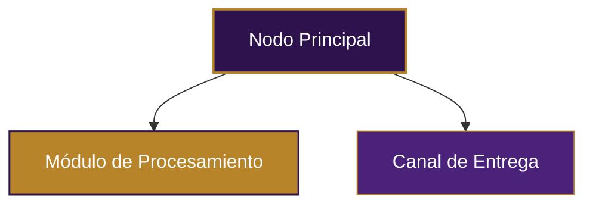

# Guía de Estilos y Maquetación Documental — La Lupa News

Esta habilidad rige la creación, maquetación, formato y auditoría de todo documento formal, informe técnico, propuesta ejecutiva y acta para **La Lupa News** y clientes de Marca Personal de **Leonel Salcedo**.

---

## 1. Reglas Fundamentales de Gobernanza y Autoría

| Parámetro | Valor Oficial Obligatorio |
| :--- | :--- |
| **Cliente Corporativo** | **La Lupa News** |
| **CEO del Destinatario** | **Javier Fernández Franco** |
| **Autor Institucional** | **Leonel Salcedo — Dirección y Consultoría Tecnológica** |
| **Régimen de Cuenta** | Cliente Exclusivo de Marca Personal de Leonel Salcedo |
| **Prohibición de Coautoría** | ❌ **PROHIBIDO mencionar a Daniel Moncada** o sociedades compartidas en La Lupa News. |
| **Prohibición de Alias** | ❌ **PROHIBIDO usar el alias "Nomack"** de cara al cliente Javier Fernández Franco. |

---

## 2. Paleta Cromática Institucional

| Rol Cromático | Hex | Uso Estricto |
| :--- | :---: | :--- |
| **Primario de Autoridad** | `#2d124d` | Títulos H1/H2, nodos raíz en diagramas, negritas de énfasis conceptual. Sustituye al `#1a3a5c` de Génesis Legal. |
| **Morado Profundo** | `#220d3a` | Énfasis tipográfico de máximo contraste en cuerpo de texto. |
| **Dorado Institucional** | `#b8842a` | Filetes separadores, etiqueta `PRESENTADO A:`, numeraciones (`1.`, `2.`), viñetas clave y acento en diagramas. |
| **Cuerpo de Lectura** | `#222222` | Texto general (fuente Cambria 11pt, interlineado 1.15, justificado). |
| **Metadatos y Headers** | `#777777` | Encabezados de página interior, pie de página y metadatos de autoría. |
| **Separador de Footer** | `#cccccc` | Línea horizontal superior del pie de página. |

---

## 3. Estructura de Portada Institucional (9 Niveles)

Todo entregable formal o reporte debe comenzar con una portada de 9 niveles centrada:

```html
<div align="center">

**<font color="#b8842a" size="2">LA LUPA NEWS — ESTRATEGIA DIGITAL Y TECNOLOGÍA</font>**

<br/>

**<font color="#2d124d" size="3">[CATEGORÍA DEL DOCUMENTO, EJ. INFORME TÉCNICO Y ARQUITECTURA DIGITAL]</font>**

# <font color="#2d124d" size="6">[TÍTULO PRINCIPAL DEL DOCUMENTO EN CALIBRI BOLD]</font>

<br/><br/>

*<font color="#666666" size="4">[Nombre del Proyecto / Subtítulo Descriptivo]</font>*

<br/><br/>

**<font color="#b8842a" size="2">PRESENTADO A:</font>**

## <font color="#2d124d" size="5">JAVIER FERNÁNDEZ FRANCO</font>
<font color="#111111" size="3">CEO — La Lupa News</font>

<br/><br/>

---

<font color="#777777" size="2">
Presentado por: <b>Leonel Salcedo</b> — Dirección y Consultoría Tecnológica<br/>
Fecha de Emisión: [Mes Año] | Versión: [X.X] Oficial<br/>
Estado: Aprobado para Implementación
</font>

</div>

<div style="page-break-after: always;"></div>
```

---

## 4. Encabezados y Pies de Página en Páginas Interiores

### Header Interior
```markdown
> **LA LUPA NEWS | [Título Corto o Tipo de Documento]**  
> *Confidencial — Uso Exclusivo de Dirección General*

---
```

### Footer Interior
```html
---
<div align="left">
<font color="#777777" size="1">
Leonel Salcedo — Dirección y Consultoría Tecnológica | Confidencial — La Lupa News
</font>
</div>
```

---

## 5. Títulos Interiores y Diagramas Mermaid

### Títulos de Sección
- El número de sección va en **Dorado (`#b8842a`)**.
- El texto del título va en **Morado Marca Personal (`#2d124d`)**.
- Línea separadora horizontal (`---`) inmediatamente debajo de cada sección principal.

### Diagramas Mermaid Estilizados
Todo diagrama debe incorporar las clases oficiales:


---

## 6. Anti-Patrones Estrictos

- ❌ **JAMÁS usar `#1a3a5c`** (código de Génesis Legal / proyectos corporativos de sociedad).
- ❌ **JAMÁS nombrar a Daniel Moncada** en ningún entregable de La Lupa News.
- ❌ **JAMÁS emitir documentos sin portada estructurada** o sin la paleta Morado `#2d124d` + Dorado `#b8842a`.
- ❌ **JAMÁS usar el alias "Nomack"** en documentos oficiales de cara al cliente Javier Fernández Franco.
