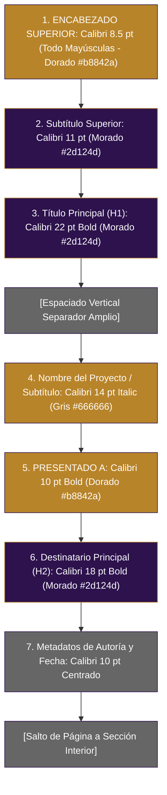
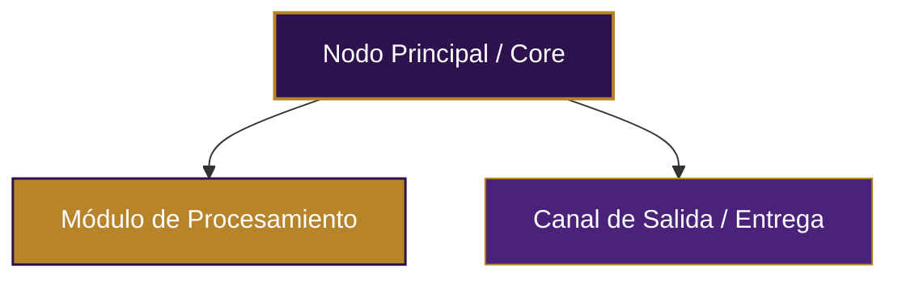

# Manual de Estilo, Maquetación y UI Documental — La Lupa News

> **Emisor**: Agente Especializado en Documentación & Consultoría Tecnológica  
> **Proyecto**: Portal Digital, Arquitectura Web & Estrategia Tecnológica — La Lupa News  
> **Destinatario Institucional**: Javier Fernández Franco — CEO, La Lupa News  
> **Autor Corporativo**: Leonel Salcedo — Dirección y Consultoría Tecnológica (Marca Personal)  
> **Aplicación**: Obligatoria para todos los Informes Técnicos, Actas, Manuales, Propuestas y Entregables Ejecutivos de La Lupa News (en Markdown, Google Docs y Word `.docx`).

---

## 1. Visión General y Gobernanza de Marca Personal

Para todos los proyectos y clientes directos de **Leonel Salcedo** (clientes propios donde no participa la sociedad con Daniel Moncada), como **La Lupa News** (liderada por su CEO Javier Fernández Franco), la identidad visual documental adopta la paleta de **Marca Personal**, sustituyendo el azul corporativo de la sociedad (`#1a3a5c`) por el **Morado Imperial de Marca Personal (`#2d124d`)**.

Se preserva con total rigor la jerarquía tipográfica, el contraste WCAG 2.1 AAA, la maquetación de portadas centradas, los filetes dorados y la estructura documental de alta gama.

---

## 2. Paleta de Colores Oficial — Clientes Marca Personal (La Lupa News)

| Rol del Color | Código Hexadecimal | Uso Principal |
| :--- | :---: | :--- |
| **Morado Principal Marca Personal** | `#2d124d` | Títulos principales (H1/H2), nombres institucionales, nodos raíz y negritas destacadas. |
| **Morado Profundo de Énfasis** | `#220d3a` | Negritas de fuerte contraste dentro de párrafos y sombras de acento. |
| **Dorado Institucional de Acento** | `#b8842a` | Subtítulos "PRESENTADO A", etiquetas "Presentado por:", líneas separadoras H1/H2, enumeraciones y filetes de cabecera. |
| **Negro / Carbón de Lectura** | `#111111` / `#222222` | Cuerpo de texto general y subtextos descriptivos. |
| **Gris Secundario / Metadatos** | `#666666` / `#777777` | Texto de encabezados, texto de pie de página y metadatos de portada. |
| **Gris Separador** | `#cccccc` | Línea horizontal superior del pie de página. |

---

## 3. Estructura y Jerarquía Tipográfica de la Portada (Cover Page)

La portada institucional debe ocupar **toda la primera página** y estar **completamente centrada tanto en sentido vertical como en sentido horizontal**, sin encabezados ni pies de página repetitivos (`Different First Page = True`):

### Especificación Detallada de Campos en Portada

1. **ENCABEZADO (Categoría / Top Header)**: `Calibri 8.5 pt`, Mayúsculas fijas, color **Dorado** (`#b8842a`). Ej: `LA LUPA NEWS — ESTRATEGIA DIGITAL Y TECNOLOGÍA`.
2. **Subtítulo superior (Antes del título principal)**: `Calibri 11 pt`, Negrita, color **Morado Marca Personal** (`#2d124d`).
3. **Título Principal (H1)**: `Calibri 22 pt`, Negrita (**Bold**), color **Morado Marca Personal** (`#2d124d`).
4. **Espaciado Vertical Separador**: Separación holgada entre el bloque superior y el bloque institucional.
5. **Nombre del Proyecto / Subtítulo Inferior**: `Calibri 14 pt`, Cursiva (*Italic*), color **Gris Medio** (`#666666`).
6. **Etiqueta "PRESENTADO A"**: `Calibri 10 pt`, Negrita (**Bold**), color **Dorado** (`#b8842a`).
7. **Destinatario Principal (H2)**: `Calibri 18 pt`, Negrita (**Bold**), color **Morado Marca Personal** (`#2d124d`).  
   - Destinatario: **Javier Fernández Franco**
   - Cargo: **CEO — La Lupa News** (Calibri 12 pt, Negro `#111111`).
8. **Metadatos de Autoría y Fecha**: `Calibri 10 pt` centrado:  
   - `Presentado por: Leonel Salcedo | Consultoría Tecnológica & Transformación Digital`  
   - `Fecha: [Mes Año] | Estado: Versión Oficial Aprobada`
9. **Salto de Página**: División formal de sección hacia las páginas interiores.

---

## 4. Estándar de Encabezado (Header) y Pie de Página (Footer) en Páginas Interiores

A partir de la página 2 rigen los siguientes encabezados y pies de página:

### A. Encabezado de Documento (Header)

- **Contenido**: `LA LUPA NEWS | [Tipo de Documento o Título Corto]`
- **Tipografía y Tamaño**: `Calibri 8.5 pt`, alineado a la derecha, color **Gris** (`#777777`).
- **Línea Separadora Inferior**: **Línea horizontal contigua de color Dorado (`#b8842a`)**.

### B. Pie de Página (Footer)

- **Contenido**: `Leonel Salcedo — Dirección y Consultoría Tecnológica | Confidencial — La Lupa News`
- **Tipografía y Tamaño**: `Calibri 8.5 pt`, alineado a la izquierda, color **Gris** (`#777777`).
- **Línea Separadora Superior**: **Línea horizontal contigua de color Gris (`#cccccc`)**.

---

## 5. Reglas Generales de Maquetación de Cuerpo de Texto

1. **Tipografía del Cuerpo de Texto**: Fuente **Cambria**, tamaño **11 pt**, interlineado 1.15, texto justificado, color de texto principal `#222222`.
2. **Títulos de Sección (H1, H2)**:
   - Enumeración (`1.`, `2.`, `3.`): en **Dorado (`#b8842a`)**, `Calibri 14 pt`, Negrita.
   - Texto del Título: en **Morado Marca Personal (`#2d124d`)**, `Calibri 14 pt`, Negrita.
   - **Línea Divisoria Obligatoria**: Justo debajo de cada título de sección debe incluirse una **línea horizontal contigua de color Dorado (`#b8842a`)** (en Markdown representada con `---`).
3. **Viñetas y Listas Numeradas**:
   - Viñetas (`•`) y números destacados: en **Dorado (`#b8842a`)**, fuente Cambria 11 pt Bold.
   - Títulos o etiquetas de viñeta: en **Morado Marca Personal (`#2d124d`)**, Negrita.
   - Cuerpo de la viñeta: en **Cambria 11 pt**, color `#222222`.
4. **Negritas de Énfasis en Texto**: Color **Morado Profundo (`#2d124d`)**.
5. **Autores Oficiales**: Acreditar exclusivamente a **Leonel Salcedo — Dirección y Consultoría Tecnológica** (o Nomack Studio según corresponda).  
   > *Nota de Gobernanza*: En proyectos directos de Leonel Salcedo (como La Lupa News) **NO se incluye a Daniel Moncada**, ya que corresponde a la línea de consultoría de marca personal exclusiva de Leonel Salcedo.
6. **Prohibición de Alias**: Mantener la formalidad corporativa acreditando a **Leonel Salcedo** en todos los encabezados y firmas.

---

## 6. Diagramas Mermaid Estilizados

Todos los diagramas técnicos de arquitectura o flujo para La Lupa News deben incorporar las clases de estilo con los tokens de color oficiales:

