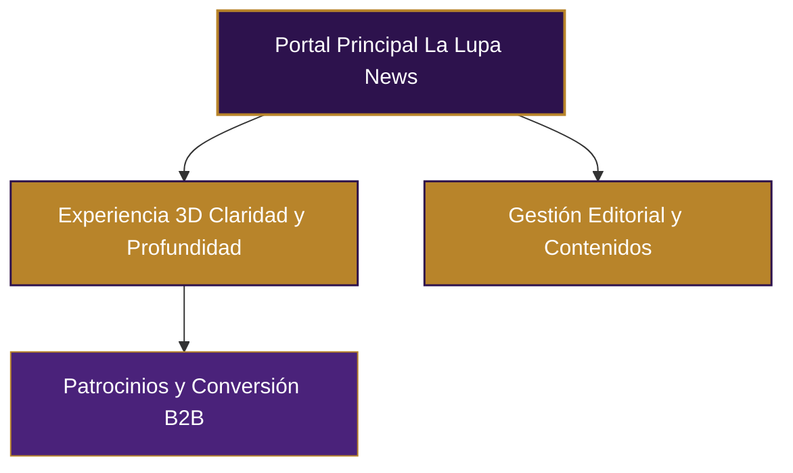

# PLANTILLA MAESTRA: DOCUMENTO EJECUTIVO — LA LUPA NEWS

<!-- ========================================== -->
<!-- 1. PORTADA INSTITUCIONAL (COVER PAGE)      -->
<!-- ========================================== -->

**LA LUPA NEWS — ESTRATEGIA DIGITAL Y TECNOLOGÍA**

 

**INFORME TÉCNICO Y ARQUITECTURA DIGITAL**

# [TÍTULO PRINCIPAL DEL DOCUMENTO EN CALIBRI BOLD]

  

*Portal Digital & Experiencia Interactiva "Claridad y Profundidad"*

  

**PRESENTADO A:**

## JAVIER FERNÁNDEZ FRANCO
CEO — La Lupa News

  

---

Presentado por: <b>Leonel Salcedo</b> — Dirección y Consultoría Tecnológica 
Fecha de Emisión: Octubre de 2026 | Versión: 1.0 Oficial 
Estado: Aprobado para Implementación

<!-- ========================================== -->
<!-- 2. ENCABEZADO Y PIE DE PÁGINAS INTERIORES  -->
<!-- ========================================== -->

> **LA LUPA NEWS | Informe Técnico Ejecutivo**  
> *Confidencial — Uso Exclusivo de Dirección General*

---

## 1. Resumen Ejecutivo y Objetivos

El presente documento establece las directrices de arquitectura y ejecución tecnológica para **La Lupa News**, bajo la dirección de su CEO **Javier Fernández Franco**, garantizando los más altos estándares de rendimiento, experiencia interactiva y posicionamiento digital.

### 1.1. Pilares Estratégicos
- **Rendimiento y Fidelidad Visual**: Experiencias interactivas fluidas optimizadas bajo la norma ISO/IEC 25010.
- **Monetización y Retención**: Infraestructura técnica diseñada para tracción de audiencia cualificada y patrocinios comerciales.
- **Gobernanza Tecnológica**: Control de versiones, auditoría continua y despliegue automatizado.

---

## 2. Diagrama de Arquitectura y Flujo

---

Leonel Salcedo — Dirección y Consultoría Tecnológica | Confidencial — La Lupa News

