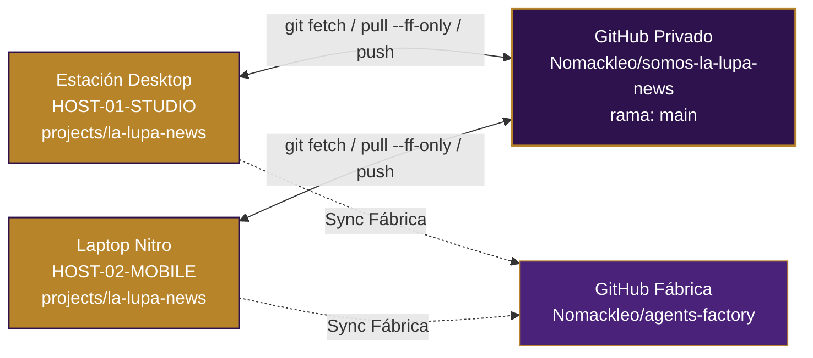

# Protocolo de Seguridad ISO 27001 y Sincronización Multi-Host — La Lupa News (`NS-LLN-GOV-003`)

| Campo de Control ISO 9001 (Cláusula 7.5) | Valor Canónico |
| :--- | :--- |
| **Código de Documento** | `NS-LLN-GOV-003` |
| **Versión SemVer** | `1.0.0` |
| **Fecha de Emisión / Revisión** | `2026-11-23` |
| **Estado** | `Vigente` |
| **Autor / Aprobador** | `Leonel Salcedo (Dirección y Consultoría Tecnológica / HITL Lead)` |
| **Marcos ISO Aplicables** | `ISO/IEC 27001:2022 (A.5.8, A.8.12, A.8.19, A.8.20)` · `ISO 9001:2015 (Cl. 7.5)` · `DORA` |

---

## 1. Controles de Seguridad de la Información (ISO/IEC 27001:2022)

### 1.1. Clasificación de Activos y Bóveda Local (`.secrets/`)
| Nivel de Clasificación | Ejemplos en La Lupa News | Permitido en GitHub | Permitido en SQLite Memoria |
| :--- | :--- | :---: | :---: |
| **RESTRICTED (Secretos)** | `.secrets/*` (`lln_db_pass.txt`, `wp.txt`, hojas de accesos), `wp-config.php`, `.env`, llaves `.pem`/`.key` | ❌ **PROHIBIDO** | ❌ **PROHIBIDO** |
| **RESTRICTED_OFF_GIT (Backups)** | Respaldos cPanel `.tar`, `.tar.gz`, `.sql`, `.zip`, `.rar` (`6.98 GB` en almacenamiento en frío) | ❌ **PROHIBIDO** | ❌ **PROHIBIDO** (solo manifiesto sin PII) |
| **CONFIDENTIAL (Corporativo)** | `NS-LLN-AUD-001`, `finance/cotizaciones/`, `finance/cuentas_de_cobro/`, arquitectura técnica | ✅ Repositorio privado `Nomackleo/somos-la-lupa-news` | ✅ Metadatos controlados |
| **INTERNAL (Gobernanza)** | `AGENTS.md`, `GEMINI.md`, `docs/01_gobernanza/`, `knowledge/project_memory.json`, `scripts/` | ✅ Sí | ✅ Sí |

### 1.2. Barreras Deterministas Anti-Fuga (Defense-in-Depth)
1. **Capa 1 — `.gitignore` endurecido:** Bloquea explícitamente `.secrets/`, `backups/`, `05_Servidor_Backups/`, `*.sql`, `*.tar*`, `*.zip`, `*.rar`, `*.env`, `*pass*`, `wp-config.php`.
2. **Capa 2 — Escaneo Anti-Secretos en Memoria Local (`scripts/update_project_memory.py`):** Inspecciona patrones de tokens, claves API y credenciales antes de indexar cualquier archivo en `knowledge/project_memory.sqlite`, abortando en modo *fail-closed* si detecta exposición.
3. **Capa 3 — Exclusión en Indexador Global (`bin/indexer.py`):** Excluye `.secrets`, `05_Servidor_Backups`, `backups`, `backups_cpanel` para evitar contaminación del índice SQLite compartido de la fábrica.
4. **Capa 4 — Validación de Contratos Handoff (`bin/handoff-validator.py`):** Valida cada JSON en `pipeline/handoffs/` contra fugas de secretos antes de su registro.

---

## 2. Topología de Sincronización Multi-Estación (Desktop ↔ Laptop Nitro)



### 2.1. Configuración Inicial en **Laptop Nitro (`HOST-02-MOBILE`)**
1. Definir la variable de entorno de estación (una sola vez en PowerShell):
   ```powershell
   [System.Environment]::SetEnvironmentVariable('NOMACK_STUDIO_HOST_ID', 'HOST-02-MOBILE', 'User')
   ```
2. Sincronizar el repositorio padre de Nomack Studio (`agents-factory`):
   ```powershell
   git fetch origin --prune
   git pull --ff-only origin main
   ```
3. Clonar el proyecto desacoplado en `projects/la-lupa-news/`:
   ```powershell
   cd projects
   git clone https://github.com/Nomackleo/somos-la-lupa-news.git la-lupa-news
   ```
4. Reindexar memoria global local tras clonar (si aplica):
   ```powershell
   cd ..
   python bin\indexer.py
   ```
5. **Bóveda `.secrets/`:** Las credenciales locales **NO** viajan por GitHub; si se requieren en Laptop Nitro, se transfieren únicamente por canal cifrado punto a punto (ej. gestor de contraseñas o archivo cifrado fuera de Git) hacia `projects/la-lupa-news/.secrets/`.

### 2.2. Procedimiento Operativo Obligatorio (Pre-Flight y Post-Flight)
- **Antes de editar cualquier archivo:**
  ```powershell
  .\scripts\sync_workstation.ps1 -Action pull
  ```
- **Antes de hacer push (Post-Flight):**
  1. Actualizar memoria local: `python scripts\update_project_memory.py`
  2. Verificar `git status --short` (confirmar que `.secrets/` y archivos pesados NO aparecen).
  3. Hacer commit atómico siguiendo Conventional Commits v1.0.0 con pie obligatorio:
     ```text
     <tipo>(<alcance>): <resumen conciso>

     <detalle técnico>

     Host-Origin: HOST-01-STUDIO | HOST-02-MOBILE
     Ref-Project: la-lupa-news
     ```
  4. Publicar inmediatamente: `.\scripts\sync_workstation.ps1 -Action push`

### 2.3. Invariantes de No Destrucción
- ❌ Prohibido `git push --force` / `-f` en `main`.
- ❌ Prohibido `git reset --hard` o `git clean -fd` sin rama `backup/divergence-<HOST>-<TIMESTAMP>` y autorización HITL.
- ❌ Prohibido `git add .` indiscriminado; validar siempre archivos staged contra `.gitignore`.
