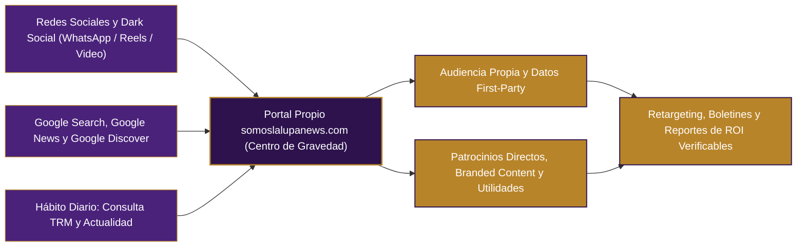
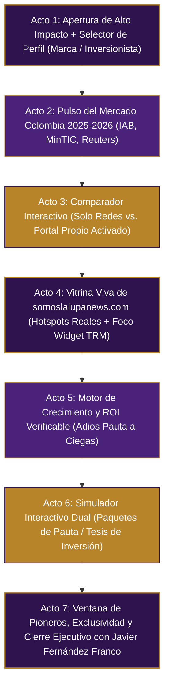

<!-- ========================================== -->
<!-- 1. PORTADA INSTITUCIONAL (COVER PAGE)      -->
<!-- ========================================== -->

**LA LUPA NEWS — ESTRATEGIA DIGITAL Y TECNOLOGÍA**

 

**ESTUDIO DE MERCADO, TESIS COMERCIAL Y ARQUITECTURA NARRATIVA**

# ESTUDIO DE MERCADO 2025–2026 Y ESTRATEGIA NARRATIVA PARA EL PITCH COMERCIAL Y DE INVERSIÓN

  

*Base Estratégica de Mercado, Monetización Digital y Diseño de Experiencia Persuasiva para el Portal Somos La Lupa News (somoslalupanews.com)*

  

**PRESENTADO A:**

## JAVIER FERNÁNDEZ FRANCO
CEO — La Lupa News

  

---

Presentado por: <b>Leonel Salcedo</b> — Dirección y Consultoría Tecnológica 
Fecha de Emisión: Noviembre de 2026 | Versión: 1.0 Oficial 
Estado: Documento Estratégico Interno para Diseño de Pitch Interactivo

<!-- ========================================== -->
<!-- 2. ENCABEZADO DE PÁGINAS INTERIORES        -->
<!-- ========================================== -->

<b>LA LUPA NEWS | Estudio de Mercado y Estrategia Narrativa (NS-LLN-GOV-004)</b>

---

| Campo de Control ISO 9001 (Cláusula 7.5) | Valor Canónico |
| :--- | :--- |
| **Código de Documento** | `NS-LLN-GOV-004` |
| **Versión SemVer** | `1.0.0` |
| **Fecha de Emisión / Revisión** | `2026-11-23` |
| **Estado** | `Vigente` |
| **Autor / Aprobador** | `Leonel Salcedo (Dirección y Consultoría Tecnológica / HITL Lead)` |
| **Marcos ISO Aplicables** | `ISO 9001:2015 (Cl. 7.1.6 & 7.5)` · `ISO/IEC 27001:2022` · `ISO/IEC 42001:2023` |

---

> [!IMPORTANT]
> **Propósito de este documento**: Proveer al equipo de arquitectura del pitch comercial y de inversión (*Somos La Lupa News*) datos verificados del mercado colombiano y latinoamericano (2025–2026), argumentos sólidos para anunciantes e inversionistas, y mecánicas invisibles de interacción persuasiva. Todo el contenido está estructurado para traducirse a un **tono 100% comercial, ejecutivo, cercano y moderno**, libre de jerga técnica o forense en la pieza final orientada al cliente.

---

## 1. Resumen Ejecutivo y Tesis Central de Posicionamiento
---

El ecosistema publicitario y mediático de Colombia y América Latina atraviesa en 2025–2026 un punto de inflexión favorable para los **medios digitales independientes con activo web propio**. Mientras la inversión en publicidad digital en Colombia superó los **$3,04 billones COP** al cierre de 2025 —concentrando el **59% de toda la pauta en medios del país** según IAB Colombia— y aceleró un **+9,1% interanual en el Q2 de 2026** (con crecimientos explosivos de **+34,4% en Display** y **+90,5% en Branded Content**), los anunciantes enfrentan simultáneamente dos dolores críticos: la **volatilidad algorítmica de las redes sociales** y la **crisis de confianza y seguridad de marca** en entornos saturados de desinformación.

Frente a este escenario, **Somos La Lupa News** (`somoslalupanews.com`) no debe presentarse como un portal pasivo ni intentar ocultar un periodo reciente de pausa editorial; por el contrario, su narrativa ganadora consiste en posicionarse como un **Activo Digital Listo para Ignición Comercial (*Turnkey Media Platform*)**: una vitrina editorial moderna, creíble y ya estructurada —incluyendo herramientas de utilidad cotidiana como el **Widget de TRM diaria**— preparada para escalar de forma acelerada y medible mediante la activación de una **campaña inteligente de marketing, distribución y analítica de retorno**.

### 1.1. Propuesta de Valor Dual (Anunciantes e Inversionistas)

* **Para Marcas y Anunciantes (Track Comercial)**: Visibilidad garantizada en un entorno editorial seguro (*brand safety*), formatos nativos y de patrocinio de alto recuerdo (hasta **3x–10x mayor CTR** y **+20,6% de *brand lift*** frente a banners tradicionales), presencia diaria en utilidades financieras de alta intención (TRM) y **reportes verificables de retorno y atribución** que eliminan la "pauta a ciegas".
* **Para Inversionistas y Capital Semilla/Crecimiento (Track Capital)**: Participación en un activo mediático ágil, de estructura de costos liviana y alto margen bruto en venta directa, construido sobre **audiencia propia (*owned media*) y datos propios (*first-party data*)**, con potencial de múltiplos de valoración superiores (**6x a 12x+ EBITDA** en medios especializados con ingresos diversificados frente a portales dependientes de tráfico prestado).

---

## 2. Radiografía del Mercado Digital en Colombia y LATAM (2025–2026)
---

Los indicadores macroeconómicos y sectoriales confirman que el consumo informativo y los presupuestos publicitarios están plenamente consolidados en el entorno móvil y digital.

### 2.1. Conectividad e Infraestructura Digital en Colombia (2025–2026)

De acuerdo con los informes de **DataReportal (Kepios / GSMA Intelligence)** y el **MinTIC (Ministerio TIC de Colombia)**:

| Indicador de Conectividad (Colombia) | Cifra 2025 | Cifra 2026 | Implicación Comercial para La Lupa News |
| :--- | :---: | :---: | :--- |
| **Penetración de Internet** | 77,3% – 77,8% (~41,1–41,7 M) | **80,9% (~43,7 millones)** | Audiencia digital masiva y madura en expansión constante. |
| **Conexiones Móviles Celulares** | ~83,0 millones (155% pob.) | **87,6 millones (162% pob.)** | El smartphone es el primer canal de acceso informativo y comercial. |
| **Accesos a Internet Móvil (MinTIC)** | ~47+ millones | **49,6 millones** (92–93/100 hab.) | Cobertura prácticamente universal de banda ancha móvil (4G/5G). |
| **Despliegue de Conexiones 5G** | Fase inicial | **+10,7 millones (mediados 2026)** | Permite formatos ricos, video corto y experiencias web rápidas sin fricción. |
| **Consumo Promedio de Datos Móviles** | Creciente | **19,9 GB / mes por línea** | Alta tolerancia a consumo multimedia, portales visuales y *branded content*. |
| **Internet Fijo (Fibra Óptica)** | Expansión urbana | **10,78 millones** (+6,6 M fibra) | Lectura profunda y consulta laboral/financiera desde escritorio en oficinas. |

*Fuentes: DataReportal Digital Colombia (2025–2026); Boletines Trimestrales de Conectividad MinTIC (2025–2026).*

### 2.2. Inversión Publicitaria Digital en Colombia (IAB Colombia 2025–2026)

El mercado publicitario digital colombiano ha demostrado resiliencia y crecimiento sostenido, consolidándose como el principal destino de los presupuestos de mercadeo:

* **Cierre Total 2025 (IAB Colombia)**: La inversión digital alcanzó los **$3,04 billones COP** (+**7,6%** frente a 2024), capturando el **59% de la inversión publicitaria total en medios** del país.
  * **Social Media**: ~$911.734 millones COP (~30% de participación).
  * **Video Digital**: ~$858.169 millones COP (+13,1% interanual).
  * **Search (Buscadores)**: ~$523.987 millones COP.
  * **Display**: ~$459.214 millones COP.
  * **Influencer Marketing**: ~$227.360 millones COP (+23,1% interanual).
  * **Branded Content**: Crecimiento superior al **+66%** interanual en 2025.
* **Aceleración en 2026 (Q1 y Q2 — último reporte oficial liberado)**:
  * **Q1 2026**: $442.612 millones COP (estacionalidad habitual de inicio de año).
  * **Q2 2026**: Saltó a **$847.662 millones COP**, lo que significó un repunte de **+91,5% frente a Q1 2026** y un crecimiento interanual de **+9,1%** frente a Q2 2025 ($777.209 millones), impulsado por ciclos comerciales y eventos masivos como la Copa Mundial de la FIFA 2026.
  * **Formatos ganadores en Q2 2026**: **Video Digital** lideró con 32,1% ($272.396 millones, +19,2% YoY), seguido por Social Media (25,3%) y Search (18,6%). De forma crucial para portales editoriales, **Display creció +34,4%** ($125.834 millones, 14,8% del total) y **Branded Content se disparó +90,5%** ($9.500 millones).
  * *(Nota metodológica: A noviembre de 2026, el reporte consolidado Q3 2026 de IAB Colombia aún se encuentra en fase de cierre y publicación oficial).*

### 2.3. Contexto Regional LATAM (EMARKETER / Statista 2025–2026)

* En América Latina, el gasto publicitario digital cruzó de manera estructural el umbral mayoritario, representando aproximadamente el **56,4% de la inversión total en medios** (EMARKETER).
* El ascenso vertiginoso de las **Retail Media Networks** (lideradas por Mercado Ads con proyección >10% del gasto digital regional, junto a Rappi y retailers locales) elevó el estándar de exigencia de los anunciantes: hoy las marcas esperan **entornos medibles, datos propios (*first-party data*) y atribución de negocio real**, no solo impresiones genéricas.

### 2.4. Consumo de Noticias y Oportunidad de Confianza en Colombia (Reuters Institute 2025–2026)

El *Digital News Report* del **Reuters Institute for the Study of Journalism (Universidad de Oxford)** —ediciones 2025 y 2026— expone una paradoja estratégica de enorme valor comercial para `somoslalupanews.com`:

1. **Dominio Móvil Absoluto**: El **75% de los colombianos** accede a las noticias desde su teléfono inteligente (vs. 54% en computador y 27% en tablet). En portales locales, entre el **75% y el 85%** de la lectura proviene de dispositivos móviles.
2. **Descubrimiento Social y "Dark Social"**: El **72%** usa redes sociales para informarse (Facebook 47%, WhatsApp 35%, YouTube 34%, Instagram 28%, TikTok 27% —el de mayor crecimiento con +5 pp—, X 13%). En 2026, el **35%** consume noticias semanalmente vía creadores e *influencers* (40% en jóvenes de 18–24 años).
3. **Brecha de Confianza y Riesgo de Marca**: La confianza general en las noticias en Colombia cayó del **32% en 2025** a un mínimo histórico del **25% en 2026**, mientras el **59%** declara alta preocupación por las *fake news*, señalando a políticos e *influencers* como los principales focos de desinformación.

> [!TIP]
> **Lectura Comercial para el Pitch**: Lejos de ser una amenaza, la desconfianza hacia las redes sociales desreguladas es el **mejor argumento de venta para un portal periodístico propio y curado**. Las marcas serias temen aparecer junto a desinformación, polarización agresiva o contenido sin control (*brand safety*). `somoslalupanews.com` ofrece un entorno limpio, ordenado y creíble que transfiere autoridad editorial al anunciante (**efecto halo de marca**).

---

## 3. Portal Propio (somoslalupanews.com) vs. Dependencia Exclusiva de Redes Sociales
---

Uno de los pilares centrales del pitch comercial y de inversión consiste en demostrar, con claridad ejecutiva y sin tecnicismos, por qué **poseer un portal de noticias independiente** multiplica el valor frente a operar únicamente en redes sociales ("tierra alquilada").

### 3.1. El Cambio Estructural del Tráfico Digital (2025–2026)

* **Caída del alcance orgánico en redes**: Las plataformas sociales (Meta/Facebook, X, TikTok) penalizan progresivamente los enlaces externos para retener al usuario dentro de sus aplicaciones. Depender 100% de redes implica pagar peaje constante cada vez que cambia el algoritmo.
* **Búsquedas sin clic (*Zero-Click*) y el "Gran Giro" de Google Discover**: Con los resúmenes de IA en buscadores, las búsquedas sin clic superaron el **68%** a inicios de 2026. En contraste, **Google Discover** pasó a concentrar cerca del **67,5% del tráfico móvil** que Google envía a medios de noticias (NewzDash), premiando portales propios con fuerte relevancia local, experiencia visual limpia y señales de autoridad (*E-E-A-T*).
* **Auge del Tráfico Directo y *Dark Social***: Los canales que conectan directamente al medio con su lector —WhatsApp (usado por el 35% de colombianos para noticias), boletines por correo (*newsletters*) y navegación interna en el portal (~41% del tráfico en medios optimizados)— se consolidan como los activos más rentables y resilientes.

### 3.2. Matriz Comparativa: Activo Propio vs. Dependencia de Redes

| Dimensión Estratégica | Solo Redes Sociales ("Terreno Alquilado") | Portal Propio `somoslalupanews.com` ("Activo Propio") |
| :--- | :--- | :--- |
| **Propiedad de la Audiencia** | Pertenece a la plataforma; si cambia el algoritmo o se bloquea la cuenta, el alcance desaparece. | **Audiencia propia** y base de datos consentida (*first-party data*) bajo Ley 1581 de 2012. |
| **Descubrimiento Orgánico** | Efímero (vida útil de horas en el feed). | **Perenne y acumulativo**: SEO en Google, Google News y picos masivos en **Google Discover**. |
| **Entorno de Marca (*Brand Safety*)** | Impredecible; el anuncio puede aparecer junto a polémicas o contenido no verificado. | **100% controlado y curado**; transfiere credibilidad periodística (+9% afinidad de marca). |
| **Espacios de Alta Intención** | Interrupción pasiva durante entretenimiento. | **Utilidades diarias de decisión**, como el **Widget de TRM**, secciones de economía, política y actualidad. |
| **Economía Publicitaria** | Compite en subastas saturadas con bajo control sobre el precio y el formato. | **Venta directa premium**: patrocinios exclusivos, *branded content*, toma de portada y paquetes integrados. |
| **Valor Patrimonial (Inversión)** | Bajo valor transferible; alto riesgo de plataforma. | **Activo digital valorizable** (dominio, histórico indexado, datos propios, contratos directos recurrentes). |

*Nota estratégica*: Las redes sociales no se descartan; se reasignan a su rol óptimo como **canales de captación y amplificación** que dirigen tráfico cualificado hacia el centro de gravedad comercial: `somoslalupanews.com`.

---

## 4. Benchmarks de Monetización y la Ventaja Estratégica del Widget TRM
---

Para que tanto anunciantes como inversionistas validen el potencial económico del portal, el pitch debe anclarse en referencias reales de desempeño y tarifas del mercado colombiano y latinoamericano (2025–2026).

### 4.1. Benchmarks de Desempeño y Tarifas (Colombia / LATAM 2025–2026)

| Formato Publicitario | CTR Promedio | CPM Referencial (USD) | Atención / Recuerdo / Impacto en Marca | Rol Comercial en La Lupa News |
| :--- | :---: | :---: | :--- | :--- |
| **Display Estándar (Banner IAB)** | 0,05% – 0,10% | $0,80 – $2,00 (programática) | *Brand lift* ~+10%; recuerdo ~65%; susceptible a "ceguera de banner". | Volumen base, recordación visual y *retargeting* de audiencia. |
| **Nativo Open-Web (Widgets)** | 0,30% – 0,70% (>0,40% fuerte) | $0,80 – $2,50 ($1,50+ CO) | Mayor integración visual que display tradicional. | Monetización complementaria al final de artículos. |
| **Nativo Editorial / *In-Feed* Directo** | **0,50% – 1,20%** (3x–10x vs banner) | **$2,50 – $6,00+** (Tier-1 / picos) | **+53% mayor tiempo de atención visual**; *brand lift* promedio **+20,6%**. | Producto estrella de pauta directa en portada y secciones clave. |
| ***Branded Content* / Nota Patrocinada** | Alto tiempo de lectura (minutos) | **Tarifa fija por paquete** (alto margen) | Recuerdo espontáneo hasta **86%**; intención de compra **+15% a +18%**; afinidad **+9%**. | Solución premium para marcas que requieren explicar propuesta de valor y reputación. |
| **Patrocinio Exclusivo Widget TRM** | Alta recurrencia diaria | **Fee mensual exclusivo** (*Share of Voice* 100%) | Asociación diaria con decisión financiera; tráfico recurrente y orgánico constante. | **Ancla de ingresos recurrentes** y vitrina de élite para banca, fintech y comercio exterior. |

*Fuentes: Native Advertising Institute / Brand Metrics; IAB Colombia (2025–2026); benchmarks regionales LATAM (Osmos, Advino Media, Superads, Readpeak).*

### 4.2. El Caso Comercial del Widget de TRM Diaria (Utilidad Financiera de Alta Intención)

En Colombia, las búsquedas y consultas diarias sobre **"dólar hoy"** y **"TRM hoy"** (certificada por la Superintendencia Financiera de Colombia / Set-FX) constituyen uno de los patrones de demanda digital más estables, masivos y recurrentes del país. No dependen de una coyuntura aislada: responden a hábitos cotidianos de empresarios, importadores, exportadores, viajeros, inversionistas, receptores de remesas y consumidores digitales.

* **De Medio Informativo a Herramienta de Hábito Diario**: Integrar y destacar el Widget TRM en `somoslalupanews.com` crea un motivo de visita repetida (*repeat visit loop*) todas las mañanas y al cierre del mercado, multiplicando la retención sin depender de viralidad pasajera.
* **Verticales de Anunciantes con Mayor Disposición de Pago**:
  1. **Fintechs, Neobancos y Remesadoras** (ej. transferencias internacionales, cuentas multidivisa, pasarelas de pago — vertical altamente competitiva que invierte agresivamente en captar usuarios en el momento exacto de consulta de divisas).
  2. **Banca Tradicional, Comisionistas de Bolsa y Fondos de Inversión**.
  3. **Casas de Cambio, Aerolíneas, Agencias de Viajes y Hotelería Internacional**.
  4. **Logística, Comercio Exterior, Importadores y Bienes Raíces de Inversión**.
* **Empaquetamiento Comercial Recomendado**: Vender el espacio del Widget TRM bajo modalidad **"Presentado por [Marca]" (Exclusividad de Categoría — 100% *Share of Voice*)** con tarifa fija mensual + botón de acción directo (ej. *"Calcula tu envío"*, *"Abre tu cuenta en dólares"*, *"Cotiza hoy"*), acompañado de trazabilidad exacta de clics y conversiones.

---

## 5. Solución a la Objeción #1 del Anunciante y Reencuadre de Reactivación
---

### 5.1. La Objeción Principal del Mercado Colombiano en 2026

Según los lineamientos recientes de **IAB Colombia** (*Guía de Fundamentos de la Medición y Atribución en el Marketing Digital*), la industria local pasó de comprar "alcance aproximado" a exigir **transparencia, visibilidad verificada (*viewability*) y retorno atribuible por cada peso invertido**. La objeción #1 de un gerente de mercadeo ante un medio digital independiente es directa:

> *"¿Cómo sé realmente cuántas personas vieron mi marca, hicieron clic con interés real y avanzaron hacia una compra o contacto?"*

### 5.2. Cómo el Motor Inteligente de Marketing y Analítica Desactiva la Objeción

Al activar la campaña estratégica de reactivación sobre `somoslalupanews.com`, el portal se equipa con una capa completa de **Inteligencia Comercial y Trazabilidad** —que en el pitch final se comunicará en lenguaje 100% ejecutivo, nunca en jerga técnica—:

| Capacidad Operativa (Interna) | Traducción Ejecutiva para el Pitch (Sin Jerga) | Beneficio Directo para el Anunciante | Beneficio Directo para el Inversionista |
| :--- | :--- | :--- | :--- |
| **Etiquetado UTM por formato y ubicación** | *"Rastreo exacto de cada clic por espacio y anuncio"* | Sabe qué formato (TRM, nota patrocinada o portada) genera más clientes potenciales. | Demuestra qué espacios tienen mayor rentabilidad para optimizar precios. |
| **Píxeles y eventos de conversión** | *"Medición real de resultados más allá de las vistas"* | Conecta su pauta en el portal con solicitudes, WhatsApp o ventas en su propia web. | Aumenta la tasa de renovación de contratos (*Net Revenue Retention*). |
| **Audiencias propias y *retargeting*** | *"Impacto inteligente a lectores ya interesados"* | Permite re-impactar a lectores que consultaron economía o deportes sin desperdiciar presupuesto. | Construye un activo de datos propio valorizable y difícil de replicar. |
| **Distribución multicanal (SEO + Discover + WhatsApp + Newsletter)** | *"Tráfico activo y constante, no lectores por azar"* | Garantiza exposición sostenida durante toda la vigencia de la campaña. | Reduce la dependencia de un solo algoritmo o fuente de tráfico. |
| **Tablero Mensual de Resultados** | *"Reporte ejecutivo claro de retorno cada mes"* | Transparencia total para justificar presupuesto ante gerencia. | Profesionaliza la operación comercial como un medio de clase mundial. |

### 5.3. Reencuadre Honesto y Ganador del Periodo de Inactividad

Dado que `somoslalupanews.com` ha estado en pausa operativa durante los últimos meses, el pitch debe aplicar una estrategia de **transparencia inteligente y foco en potencial listo para activar**:

* **Lo que NO se debe hacer**: Inventar métricas infladas de tráfico actual ni ocultar la pausa; cualquier comprador o inversionista serio valida los datos y perdería confianza al instante.
* **La narrativa ganadora ("Plataforma Lista para Ignición")**: Presentar el portal real como un **ecosistema editorial y comercial ya construido, limpio y operativo**, que entra ahora en su **Fase de Activación Estratégica de Crecimiento**. Esto convierte el momento actual en una **ventaja de entrada temprana (*early-mover advantage*)**:
  * Para **Anunciantes Pioneros**: Acceso a tarifas preferenciales de lanzamiento y **exclusividad de categoría** en los espacios de mayor visibilidad (como el Widget TRM y la portada) antes de que el inventario se encarezca con la escalada de tráfico.
  * Para **Inversionistas**: Entrada en valoración temprana sobre una infraestructura ya creada, donde el capital no se "quema" en construir desde cero, sino que se inyecta directamente en **tracción de audiencia, producción editorial de alto impacto y aceleración comercial**.

---

## 6. Tesis Dual: Argumentario Comercial vs. Tesis de Inversión
---

### 6.1. Matriz de Valor para los Dos Públicos del Pitch

| Eje de Conversación | Enfoque A: Marcas y Anunciantes | Enfoque B: Inversionistas y Aliados de Capital |
| :--- | :--- | :--- |
| **Pregunta central que responde** | *"¿Qué gana mi marca al pautar en Somos La Lupa News?"* | *"¿Por qué invertir capital en reactivar y escalar este medio?"* |
| **Dolor que resuelve** | Pauta perdida en feeds saturados, baja credibilidad y falta de reportes claros de retorno. | Oportunidad de capturar participación en un mercado digital de **$3,04B COP (+9,1% en Q2 2026)** con un activo ya construido. |
| **Motor de ingresos / valor** | Patrocinio exclusivo TRM, *Branded Content* (+90,5% crecimiento en CO), pauta nativa *in-feed* y paquetes integrados. | Modelo **Hub-and-Spoke** diversificado: venta directa de alto margen + programática complementaria + suscripciones/boletines futuros. |
| **Ventaja defensiva** | Entorno editorial confiable (*brand safety*) + medición transparente de cada campaña. | Costos fijos livianos, dominio y plataforma propios, acumulación de *first-party data* y escalabilidad sin dependencia de terceros. |
| **Horizonte de retorno** | Visibilidad inmediata, posicionamiento y generación medible de contactos desde el primer mes. | Escalamiento rápido de inventario vendible, alto margen operativo en venta directa y múltiplos de valoración de **6x–12x+ EBITDA** en medios de nicho/regionales consolidados. |
| **Llamado a la acción (CTA)** | *"Reserva tu espacio exclusivo de lanzamiento / Solicita plan a medida"*. | *"Agenda reunión ejecutiva con Dirección General para revisar proyecciones y estructura de participación"*. |

### 6.2. Uso Inteligente del Capital en la Tesis de Inversión (Hoja de Ruta de 90–180 Días)

Para generar confianza inmediata en inversionistas, el capital se destina a **cuatro palancas productivas con métricas auditables**, evitando gastos suntuarios:

1. **Motor Editorial y Optimización Discover/SEO (35%)**: Cadencia constante de contenidos locales de alto interés, crónicas y cobertura de actualidad optimizada para captar tráfico orgánico de Google Discover y buscadores.
2. **Campaña Inteligente de Crecimiento y Distribución (30%)**: Activación pagada y orgánica en redes sociales, canales de WhatsApp y boletín propio para acelerar la masa crítica de lectores recurrentes hacia `somoslalupanews.com`.
3. **Analítica Comercial, Datos Propios y Reportes ROI (15%)**: Implementación completa de trazabilidad de campañas, segmentación de audiencias propias y tableros ejecutivos para clientes.
4. **Fuerza Comercial y Cierre de Patrocinios Ancla (20%)**: Prospección B2B directa enfocada en cerrar los primeros contratos recurrentes (Widget TRM + 3 a 5 marcas ancla en *branded content* y secciones clave).

---

## 7. Mecánicas Invisibles de Participación y Ritmo Interactivo
---

> [!CAUTION]
> **REGLA CRÍTICA DE CONFIDENCIALIDAD METODOLÓGICA (CUMPLIMIENTO ESTRICTO)**:
> Las mecánicas descritas en esta sección se extraen del acervo interno de psicología cognitiva, narrativa interactiva y diseño de experiencias para guiar la arquitectura del pitch HTML. **En la presentación final orientada a anunciantes, inversionistas y al cliente Javier Fernández Franco, ESTÁ ESTRICTAMENTE PROHIBIDO mencionar *Homo Ludens*, Johan Huizinga, teoría del juego, gamificación, Cialdini, cerebro predictivo, error lúdico o cualquier título de libro o concepto académico**, tanto en textos visibles como en tooltips, metadatos o comentarios del código. Cada mecánica debe operar de forma **100% invisible**, percibiéndose únicamente como una experiencia ejecutiva moderna, intuitiva y convincente.

A partir del análisis del repositorio interno de referencia sobre arquitectura narrativa, procesamiento predictivo, brechas de curiosidad, flujo interactivo y principios de persuasión, se establecen **7 mecánicas concretas** para inyectar de manera invisible en el pitch interactivo de *Somos La Lupa News*:

### Mecánica 1 — El Entorno Seguro de Simulación ("Simulador Interactivo de Impacto y Retorno")
* **Principio subyacente (interno)**: Creación de un espacio delimitado y libre de riesgo donde el tomador de decisiones experimenta escenarios antes de comprometer dinero real.
* **Traducción invisible en el Pitch HTML**: Un **Simulador Comercial y de Crecimiento** con controles deslizantes limpios y ejecutivos. El anunciante ajusta su presupuesto o paquete (ej. *Patrocinio TRM + Notas Patrocinadas*) y ve en tiempo real las impresiones estimadas, clics cualificados e impacto proyectado según benchmarks de Colombia. En modo inversionista, ajusta el nivel de aceleración de marketing y visualiza la curva proyectada de inventario monetizable y punto de equilibrio.
* **Efecto psicológico**: Reduce la ansiedad ante el gasto o la inversión; el prospecto "posee" el número porque él mismo lo calculó.

### Mecánica 2 — Brecha de Curiosidad y Sorpresa Predictiva ("Ruptura de Supuesto en el Acto 1")
* **Principio subyacente (interno)**: El cerebro trabaja por predicción y economiza atención ante lo predecible; solo libera atención plena cuando encuentra un contraste inesperado (*error de predicción*) o una brecha de información que necesita cerrar.
* **Traducción invisible en el Pitch HTML**: Evitar abrir con el cliché habitual (*"Quiénes somos y nuestra misión"*). Abrir con un dato contundente que rompe la creencia previa del espectador: ***"El 59% de la inversión publicitaria en Colombia ya es digital ($3,04 billones), pero el 75% de los lectores desconfía de las noticias en redes. ¿Dónde están poniendo su reputación las marcas que sí convierten?"***.
* **Efecto psicológico**: Captura atención inmediata en los primeros 5 segundos y abre una pregunta estratégica que invita a avanzar.

### Mecánica 3 — Contraste Guiado por Descubrimiento ("Comparador Interactivo Antes / Después")
* **Principio subyacente (interno)**: El aprendizaje y la convicción profundos ocurren cuando la persona contrasta por sí misma una opción débil frente a una opción estructurada, descubriendo la diferencia sin sentirse presionada por un discurso de ventas.
* **Traducción invisible en el Pitch HTML**: Un interruptor visual limpio (**"Pauta Tradicional Solo en Redes"** vs. **"Ecosistema Activado La Lupa News"**) que transforma tarjetas de indicadores en vivo: *Alcance prestado vs. Activo propio*, *Ruido sin filtro vs. Entorno editorial seguro*, *Métricas vanidosas vs. Reporte verificable de clics y contactos*.
* **Efecto psicológico**: El cliente concluye por cuenta propia que el portal activado es superior, eliminando la resistencia típica ante un vendedor.

### Mecánica 4 — Arquitectura de Exploración Libre y Agencia ("Mapa Vivo del Portal con Zonas Interactivas")
* **Principio subyacente (interno)**: Narrativa espacial y oportunidades de acción (*affordances*): cuando el usuario puede explorar libremente un entorno visual y "revelar" capas ocultas al hacer clic, su retención y sentido de control se multiplican.
* **Traducción invisible en el Pitch HTML**: Mostrar capturas reales y nítidas de `somoslalupanews.com` (desktop y móvil, con foco especial en el **Widget TRM**) equipadas con **puntos interactivos pulsantes (hotspots)** sobre cada espacio comercial: *Cabecera Premium*, *Patrocinio Exclusivo TRM*, *Artículo Patrocinado (Branded Content)*, *Banner en Lectura* y *Bloque Móvil*. Al hacer clic en cada zona, se despliega una ficha elegante con el perfil de lector, vertical recomendada, ventaja frente a banners comunes y entregables medibles.
* **Efecto psicológico**: Convierte una presentación estática en un recorrido tangible de producto real; el anunciante visualiza su marca viviendo dentro del portal.

### Mecánica 5 — Micro-Compromisos y Ruta Personalizada ("Selector de Perfil al Inicio")
* **Principio subyacente (interno)**: Principio de compromiso y coherencia (*el pie en la puerta*) combinado con estado de flujo (*flow*): pequeñas elecciones tempranas sin fricción alinean el contenido al interés exacto del visitante y aumentan su predisposición a completar el recorrido.
* **Traducción invisible en el Pitch HTML**: Un conmutador elegante siempre accesible en la navegación superior y en la apertura: **"Explorar como Marca / Anunciante"** | **"Explorar como Inversionista"** (permitiendo cambiar de vista en cualquier momento). Al elegir un perfil, los subtítulos, indicadores destacados, simulador y botón de cierre se adaptan fluidamente a sus metas.
* **Efecto psicológico**: Elimina la fatiga de leer información irrelevante y genera un compromiso sutil que culmina naturalmente en agendar reunión.

### Mecánica 6 — Reciprocidad de Valor Inmediato y Autoridad Contextual
* **Principio subyacente (interno)**: Entregar valor útil verificable antes de solicitar nada activa una predisposición positiva de reciprocidad, reforzada por señales limpias de autoridad y evidencia externa.
* **Traducción invisible en el Pitch HTML**: Antes de presentar paquetes o solicitud de capital, el pitch regala inteligencia real de mercado (cifras oficiales de IAB Colombia 2025–2026, Reuters Institute, MinTIC y benchmarks de *Branded Content* vs. Display), citadas discretamente al pie con fuentes verificables, demostrando dominio ejecutivo del sector.
* **Efecto psicológico**: Posiciona a **La Lupa News** como un socio estratégico sofisticado y confiable, no como un medio improvisado pidiendo pauta.

### Mecánica 7 — Prestigio de Primer Ocupante y Exclusividad Real de Inventario
* **Principio subyacente (interno)**: Impulso de distinción competitiva y principio de escasez legítima: las oportunidades limitadas por categoría y las posiciones de liderazgo temprano elevan significativamente el valor percibido y aceleran la decisión.
* **Traducción invisible en el Pitch HTML**: Presentar la etapa de reactivación con cupos genuinamente escasos y verificables: **"1 Único Patrocinador Exclusivo para el Widget TRM Diario"**, **"Cupos de Marcas Fundadoras de Relanzamiento (máximo 5 categorías exclusivas sin competencia directa)"** y **"Ronda Acotada de Socios Estratégicos de Aceleración"**.
* **Efecto psicológico**: Transforma la pausa previa en una ventana privilegiada de entrada exclusiva que incentiva a actuar pronto.

---

## 8. Arquitectura Narrativa Recomendada para el Plan del Pitch HTML
---

Como puente operativo para el arquitecto del plan HITL y el desarrollador de la presentación interactiva, la siguiente secuencia de **7 actos** integra los datos de mercado con las mecánicas invisibles y la regla de **cero jerga técnica**:

| Acto | Objetivo Ejecutivo | Datos Clave a Exhibir | Mecánica Invisible Aplicada | Guardarraíl de Tono (Cero Jerga) |
| :---: | :--- | :--- | :--- | :--- |
| **1** | Enganchar y segmentar al visitante | $3,04B COP pauta digital CO vs. 25% confianza en noticias en redes | Brecha de Curiosidad + Selector Dual de Perfil | Lenguaje directo de negocios y oportunidad. |
| **2** | Validar tamaño y dinamismo del mercado | 80,9% internet CO, 75% móvil, +34,4% Display y +90,5% Branded Content (Q2 2026) | Reciprocidad de Valor + Autoridad con Fuentes | Visuales limpios; máximo 3–4 cifras grandes por vista. |
| **3** | Demostrar superioridad del activo propio | 68% búsquedas sin clic, 67,5% Discover, +9% afinidad en entorno editorial | Contraste Guiado Antes/Después (Toggle) | Hablar de *"audiencia propia"* y *"reputación protegida"*, nunca de algoritmos complejos. |
| **4** | Mostrar el producto real y el Widget TRM | Capturas reales de `somoslalupanews.com` + CTR 3x–10x y recuerdo 86% en nativo/branded | Exploración Libre con Hotspots Interactivos | Usar **la identidad visual y logo reales de `somoslalupanews.com`**, no el morado/dorado de consultoría. |
| **5** | Desactivar objeción de ROI y explicar reactivación | Ecosistema de campaña inteligente + reporte mensual auditable | Transparencia de "Activo Listo para Ignición" | Decir *"trazabilidad exacta por clic y resultado"* en vez de *"UTMs, píxeles y cookies"*. |
| **6** | Permitir proyección personalizada de valor | Benchmarks reales de pauta y modelo diversificado (6x–12x+ EBITDA referencia) | Simulador Seguro Interactivo (Sliders) | Indicar con honestidad *"Escenarios ilustrativos basados en benchmarks de mercado Colombia 2025–2026"*. |
| **7** | Cerrar reunión o reserva de cupo | 1 patrocinador exclusivo TRM + cupos fundadores de relanzamiento | Exclusividad Legítima y Cierre Sin Fricción | CTA cordial y directo con datos de contacto de **La Lupa News** y su CEO **Javier Fernández Franco**. |

---

## 9. Fuentes y Referencias Verificadas
---

1. **IAB Colombia (2026)**. *Reporte de Inversión Publicitaria Digital — Cierre Total 2025 ($3,04 billones COP; 59% share; +7,6% YoY) y Reportes Trimestrales Q1 y Q2 2026 ($847.662M COP en Q2; +9,1% YoY; Display +34,4%; Branded Content +90,5%)*. Divulgado por IAB Colombia, Forbes Colombia, El Tiempo, Revista P&M y Sectorial.
2. **IAB Colombia (2025–2026)**. *Guía de Fundamentos de la Medición y Atribución en el Marketing Digital* y lineamientos regionales de transparencia y datos propios bajo marco colombiano (Ley Estatutaria 1581 de 2012).
3. **Reuters Institute for the Study of Journalism — Universidad de Oxford (2025 y 2026)**. *Digital News Report — Capítulo Colombia* (consumo móvil 75%, redes sociales para noticias 72%, auge de TikTok y creadores 35%–40%, evolución de confianza general en noticias 32% en 2025 a 25% en 2026, preocupación por desinformación 59%).
4. **DataReportal & MinTIC Colombia (2025–2026)**. *Digital Colombia 2025/2026* y *Boletines Trimestrales de Conectividad* (penetración de internet 80,9% / 43,7 millones de usuarios; 87,6 millones de líneas celulares; 49,6 millones de accesos de internet móvil; +10,7 millones de conexiones 5G; 19,9 GB consumo mensual promedio).
5. **EMARKETER / Insider Intelligence & Statista (2025–2026)**. *Latin America Digital Ad Spending & Retail Media Outlook* (participación digital ~56,4% del total de medios en LATAM; impacto de Retail Media y migración hacia atribución cerrada).
6. **NewzDash, Chartbeat, Press Gazette & Search Engine Journal (2025–2026)**. *Publisher Traffic Shifts: Google Discover (~67,5% share de tráfico móvil Google a medios), Zero-Click Searches (+68%), Dark Social y crecimiento del tráfico interno (~41%)*.
7. **Native Advertising Institute, Brand Metrics & Benchmarks LATAM (2025–2026)**. *Comparativa Display vs. Native Advertising y Branded Content* (CTR display 0,05%–0,10% vs. nativo 0,30%–1,20%; +53% atención visual; *brand lift* +20,6% vs. +10%; recuerdo hasta 86%; intención de compra +15%–18%; afinidad +9%; rangos de CPM en Colombia/LATAM).
8. **Superintendencia Financiera de Colombia / Ecosistema Fintech Colombia (2025–2026)**. Dinámica de demanda recurrente de consulta de TRM ("dólar hoy") e inversión de captación en verticales financieras y fintech.
9. **Lineup Systems / Análisis M&A Medios Digitales (2025–2026)**. *Tesis de Valoración de Medios Digitales Especializados* (múltiplos 6x–12x+ EBITDA para activos con comunidad propia, *first-party data* y patrocinios directos de alto margen).

---

Leonel Salcedo — Dirección y Consultoría Tecnológica | Confidencial — La Lupa News

