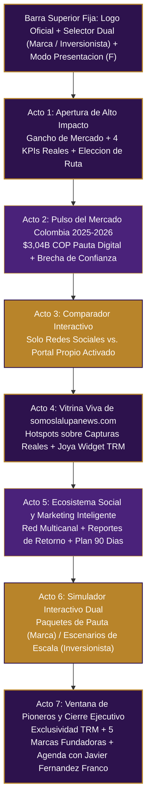

<!-- ========================================== -->
<!-- 1. PORTADA INSTITUCIONAL (COVER PAGE)      -->
<!-- ========================================== -->

**LA LUPA NEWS — ESTRATEGIA DIGITAL Y TECNOLOGÍA**

 

**PLAN MAESTRO DE PRESENTACIÓN INTERACTIVA (HITL — PRE-DESARROLLO)**

# Plan Maestro del Pitch Comercial y de Inversión — Somos La Lupa News

  

*Arquitectura de Diseño Editorial, Guion Dual (Marcas Anunciantes e Inversionistas), Mapa Interactivo de Capturas Reales y Aprobación HITL Previa al Paso 5*

  

**PRESENTADO A:**

## JAVIER FERNÁNDEZ FRANCO
CEO — La Lupa News

  

---

Presentado por: <b>Leonel Salcedo</b> | Consultoría Tecnológica &amp; Transformación Digital 
Fecha: Noviembre de 2026 | Estado: Pendiente de Aprobación HITL (Paso 4 — Previo a Desarrollo HTML)

<!-- ========================================== -->
<!-- 2. ENCABEZADO DE PÁGINAS INTERIORES        -->
<!-- ========================================== -->

<b>LA LUPA NEWS | Plan Maestro del Pitch Interactivo (NS-LLN-SPEC-002)</b>

---

| Campo de Control ISO 9001 (Cláusula 7.5) | Valor Canónico |
| :--- | :--- |
| **Código de Documento** | `NS-LLN-SPEC-002` |
| **Versión SemVer** | `1.0.0` |
| **Fecha de Emisión / Revisión** | `2026-11-23` |
| **Estado** | `Vigente (Entregable Compilado en deliverables/pitch_comercial/)` |
| **Autor / Aprobador** | `Leonel Salcedo (Dirección y Consultoría Tecnológica / HITL Lead)` |
| **Marcos ISO Aplicables** | `ISO 9001:2015 (Cl. 7.5)` · `ISO/IEC 25010:2023` · `ISO/IEC 42001:2023` |

---

> [!IMPORTANT]
> **PROPÓSITO DE ESTA COMPILACIÓN HITL (HUMAN-IN-THE-LOOP)**:  
> Este documento consolida las auditorías de mercado, marca, capturas visuales y ecosistema digital ejecutadas al **19 de noviembre de 2026** para definir el plano exacto del entregable **Paso 5 (`deliverables/pitch_comercial/Presentacion_Pitch_Comercial_Somos_La_Lupa_News.html`)**. Su aprobación por parte de **Leonel Salcedo** autoriza la construcción inmediata de la presentación interactiva autocontenida.  
>
> **Regla Crítica de Separación Visual**: Este documento interno de consultoría utiliza la paleta institucional de Marca Personal (**Morado `#2d124d` + Dorado `#b8842a`**). Por el contrario, el **Pitch HTML orientado a anunciantes e inversionistas** empleará **exclusivamente la identidad real de `somoslalupanews.com`** (**Azul Marino `#052962`**, **Azul Editorial `#346E9B`**, **Terracota `#AA5959`**, **Dorado Oliva `#B9AF07`**, superficies editoriales `#FFFFFF`/`#F7F7F7` y logotipos oficiales de `assets/branding/logos/`).

---

## 1. Resumen Ejecutivo y Tesis Estratégica del Pitch
---

El objetivo del entregable interactivo **Somos La Lupa News** es proporcionar a **Javier Fernández Franco** y a su equipo directivo una herramienta comercial moderna, persuasiva y autónoma que resuelva **dos frentes simultáneos de alto valor** desde una sola pieza digital:

1. **Frente Comercial (Marcas y Anunciantes)**: Vender espacios publicitarios directos, patrocinios de sección, *branded content* y el **Patrocinio Exclusivo del Widget TRM Diario**, desactivando la objeción #1 del mercado colombiano (*«¿Cómo mido el retorno real de mi pauta?»*).
2. **Frente de Capital (Inversionistas y Aliados Estratégicos)**: Sustentar una tesis clara y honesta de inyección de capital sobre un activo mediático ya construido y listo para acelerar tracción, ingresos directos y valor patrimonial.

### 1.1. Encuadre Honesto y Ganador: «Maqueta Viva Lista para Reactivación»

La auditoría verificada al **19 de noviembre de 2026** confirma que `somoslalupanews.com` cuenta con un archivo real de **4.583 publicaciones periodísticas** (publicadas entre octubre de 2024 y el 20 de marzo de 2026) y atraviesa actualmente una pausa operativa de ~8 meses. Lejos de ocultar esta realidad o inflar cifras inexistentes, el pitch convierte este contexto en su mayor argumento de cierre:

* **Plataforma Real y Comprobada (No es un boceto vacío)**: Respaldada por **4.583 artículos** en 20 verticales (Colombia 2.312, Mundo 668, Deportes 657, Poder/Política 591, Historias 126, Opinión 71, Economía y Negocios), con capacidad histórica demostrada superior a **1.100 noticias por trimestre**.
* **Prueba Comercial Real de Marcas Reconocidas**: El portal ya exhibe arquitectura publicitaria probada con presencia real de **Café Águila Roja** (*«Patrocinado por Café Águila Roja»* en Deportes) y **Súper Astro** (6 posiciones display de alto impacto en portada).
* **Utilidad Financiera Viva Hoy (Widget TRM Diario)**: Operando y actualizándose diariamente en posición *above-the-fold* (`$3,327 COP` verificado el 19 de noviembre de 2026), listo para convertirse en un imán de visitas recurrentes patrocinado en exclusividad.
* **Liderazgo Mediático Nacional**: Respaldo, credibilidad y capacidad de convocatoria de **Javier Fernández Franco («El Cantante del Gol»)**, reduciendo drásticamente el costo de ganar confianza inicial frente a portales anónimos.
* **Ventaja de Entrada Temprana**: Para marcas, acceso a **exclusividad de categoría y tarifas de lanzamiento** antes de la escalada de tráfico; para inversionistas, capital destinado 100% a **tracción, crecimiento medible y monetización**, sin quemar recursos construyendo tecnología desde cero.

### 1.2. Guardarraíles de Tono y Regla Cero Fugas

* **Tono 100% Comercial, Ejecutivo, Cercano y Moderno**: Cada pantalla del HTML hablará el idioma de gerentes de mercadeo, directores de marca e inversionistas (alcance, recordación, entorno seguro, clics trazables, retorno y escalabilidad).
* **Cero Jerga Técnica ni Forense**: Prohibido mencionar en el pitch HTML palabras como *WordPress, Elementor, JSON-LD, LiteSpeed, DNS, RDAP, píxeles, UTMs, cookies, scraping* o errores técnicos del pasado. Por ejemplo, el rastreo de campañas se traduce a **«Trazabilidad exacta de cada clic y resultado»** y el remarketing a **«Reimpacto inteligente a lectores ya interesados»**.
* **Cero Fugas Metodológicas**: Todas las **Mecánicas de Enganche Interactivo** descritas en este plan operan de manera **100% invisible** dentro de la interfaz del pitch. Ningún titular, botón, tooltip, comentario de código ni etiqueta visible al cliente debe aludir a marcos académicos, teorías psicológicas o denominaciones de diseño conductual.

---

## 2. Blueprint del Sistema de Diseño del Pitch HTML (Identidad Real de Marca)
---

El archivo interactivo del Paso 5 (`Presentacion_Pitch_Comercial_Somos_La_Lupa_News.html`) heredará fielmente la personalidad editorial real extraída de `https://somoslalupanews.com` y documentada en [`assets/branding/brand_tokens.json`](../../assets/branding/brand_tokens.json).

### 2.1. Paleta Cromática Oficial del Pitch HTML (Cero Morado/Dorado)

| Rol en el Pitch HTML | Código HEX | Nombre Institucional | Aplicación Exacta en la Interfaz |
| :--- | :---: | :--- | :--- |
| **Primario Institucional** | `#052962` | Azul Marino Institucional | Portada Hero, cabecera fija, secciones de alto impacto, botones principales y footer. |
| **Primario Profundo** | `#041F4A` | Azul Marino Topbar | Barra superior de navegación/selector de perfil, fondos oscuros de contraste y barra de presentación. |
| **Tinta Editorial Principal** | `#02132F` | Azul Noche | Títulos oscuros sobre papel editorial y texto principal de alta legibilidad. |
| **Azul Editorial** | `#346E9B` | Azul Editorial | Cifras destacadas (KPIs y valores TRM `$3,327 COP`), enlaces interactivos y gráficos de tendencia. |
| **Acento Editorial** | `#AA5959` | Rojo Terracota Editorial | Etiquetas `TRM HOY`, subrayados de sección, indicadores activos de hotspots y énfasis de alerta positiva. |
| **Acento Secundario / CTA** | `#B9AF07` | Dorado Oliva | Llamados a la acción (CTA), píldoras de estado activo, conmutador seleccionado y focos de atención. |
| **Pizarra de Subtítulos** | `#2E3C46` | Gris Pizarra Azulado | Subtítulos, encabezados secundarios y leyendas de tarjetas sobre fondos claros. |
| **Lienzo Editorial Principal** | `#FFFFFF` | Blanco Puro | Secciones de lectura limpia estilo prensa digital moderna y tarjeta del Widget TRM. |
| **Superficie de Tarjetas** | `#F7F7F7` | Gris Perla | Fondos de módulos comparativos, tarjetas de inventario y paneles de simulador. |
| **Bordes y Metadatos** | `#DEE2E6` / `#69727D` | Borde Sutil / Gris Metadato | Filetes estructurales (`1px solid #DEE2E6`), fuentes bibliográficas discretas y pies de foto (`#2B2F33`). |

### 2.2. Tipografía Editorial y Comportamiento Offline

| Nivel Tipográfico | Fuente del Portal Original | Fuente Web del Pitch HTML (Google Fonts + Fallback) | Uso en el Pitch |
| :--- | :--- | :--- | :--- |
| **Display y Titulares (H1/H2/KPIs)** | `MFB Oldstyle Bold` | **`Playfair Display`** (700, 800) · *Fallback: Georgia, "Times New Roman", serif* | Titulares principales de cada acto, cifras TRM y grandes indicadores de mercado. |
| **Entradillas y Citas Editoriales** | `LT Superior Serif` | **`Source Serif 4`** (400, 600, italic) · *Fallback: Georgia, serif* | Subtítulos narrativos, citas ejecutivas y contexto editorial. |
| **Cuerpo, UI y Controles** | `Funnel Sans` *(nativa)* | **`Funnel Sans`** (400, 500, 700, 800) · *Fallback: "Segoe UI", system-ui, sans-serif* | Párrafos de lectura ágil, menús, botones, sliders del simulador y fichas de hotspots. |

### 2.3. Arquitectura de Empaquetado y Experiencia de Usuario (UX)

Tomando los mejores patrones probados de navegación ejecutiva (doble modo de consumo, revelado fluido y cero fricción móvil), el entregable cumplirá con las siguientes especificaciones técnicas:

* **Archivo Único 100% Autocontenido**: `deliverables/pitch_comercial/Presentacion_Pitch_Comercial_Somos_La_Lupa_News.html` (un solo archivo `.html` distribuible por WhatsApp, correo o Google Drive que abre instantáneamente en cualquier navegador moderno sin servidor local ni carpetas externas).
* **Embebido Inteligente en Base64 (Optimización WebP/PNG)**:
  * Logotipos oficiales (`Logo 2.png`, `Logo 1.png`, `Imago favi2.png`, `Imago 1.png`, `favicon.png` en `assets/branding/logos/`) redimensionados a resolución óptima de visualización (ancho máx. 480–600 px para logos, 128 px para favicon/isotipos) y embebidos en **PNG/WebP Base64** de nitidez cristalina.
  * Las 5 capturas verificadas de `assets/captures/` convertidas a **WebP de alta fidelidad (calidad 82–85%, ancho máx. 1440 px desktop / 600 px móvil)** e incrustadas en Base64 para lograr un peso total equilibrado (**~1,6 MB – 2,8 MB**), garantizando nitidez total en pantallas Retina y apertura instantánea incluso sin conexión a internet.
* **Doble Modo de Lectura y Presentación en Vivo**:
  * **Modo Lectura Continua (por defecto)**: Desplazamiento vertical fluido con barra de progreso superior, puntos de navegación lateral (*rail* con etiquetas al pasar el cursor) y revelado suave de tarjetas.
  * **Modo Presentación Fullscreen (Botón o Tecla `F`)**: Transición horizontal diapositiva por diapositiva con barra inferior minimalista, soporte para flechas de teclado (`←` / `→`), gestos táctiles (*swipe*) en tablet/celular y tecla `Esc` para regresar.
  * **Exportación Limpia a PDF (`@media print`)**: Botón dedicado que despliega todos los paneles y oculta controles flotantes para imprimir o guardar versión ejecutiva en PDF cuando un comité de compras o inversionistas lo solicite.
* **Diseño 100% Responsivo (Desktop, Tablet y Smartphone)**: Adaptación fluida de la barra superior, el selector dual de perfil, el mapa interactivo de hotspots (con fichas legibles debajo de la captura en móvil) y los sliders del simulador.

---

## 3. Arquitectura Narrativa Dual: Guion Acto por Acto (Storyboard)
---

El pitch se estructura en **7 Actos secuenciales** potenciados por una **Barra Superior Inteligente** con conmutador de perfil persistente (**«Soy Marca / Anunciante»** ↔ **«Soy Inversionista»**). El visitante puede cambiar de perspectiva en cualquier momento y ver cómo los mensajes clave, indicadores, el simulador y el llamado a la acción se personalizan al instante.

### 3.1. Desglose Detallado de los 7 Actos (Copy Propuesto, Datos y Mecánica Interactiva)

#### Acto 1 — Apertura de Alto Impacto y Selector Dual de Perfil
* **Superficie Visual**: Fondo Azul Marino Institucional (`#052962` con degradado hacia `#041F4A`), logotipo oficial blanco (`logo_principal_fondo_azul.png`) y acentos en Dorado Oliva (`#B9AF07`) y Terracota (`#AA5959`).
* **Mecánica de Enganche Interactivo**: *Ruptura de expectativa con dato de alto contraste + selección voluntaria de perfil desde el primer segundo*.
* **Titular Propuesto (Cero Jerga)**:
  > *«El 59% de la pauta en Colombia ya es digital, pero 3 de cada 4 lectores desconfían de las redes. Tu marca merece un medio propio, creíble y medible.»*
* **Subtítulo Dinámico por Perfil**:
  * *Modo Anunciante*: **Somos La Lupa News (`somoslalupanews.com`)** reactiva su ecosistema informativo con formatos de alto recuerdo, patrocinio exclusivo del indicador diario TRM y reportes transparentes de resultados.
  * *Modo Inversionista*: Un activo mediático colombiano ya construido —con **4.583 artículos publicados**, marcas reales validadas y liderazgo nacional— listo para acelerar audiencia y monetización directa.
* **4 Tarjetas KPI de Respaldo Real**: `4.583` Historias publicadas en archivo · `$3,327 COP` Widget TRM vivo hoy · `$3,04B COP` Mercado digital Colombia · `20` Verticales editoriales activas.
* **Controles Interactivos**: Dos botones grandes de ruta inmediata (**«Explorar como Marca / Anunciante»** | **«Explorar como Inversionista»**) sincronizados con el selector de la barra superior.

#### Acto 2 — El Pulso del Mercado Digital en Colombia (2025–2026)
* **Superficie Visual**: Papel Editorial Blanco (`#FFFFFF`) con tarjetas `#F7F7F7` y cifras en `Playfair Display` `#346E9B`.
* **Mecánica de Enganche Interactivo**: *Aporte inmediato de inteligencia verificada de mercado para construir autoridad ejecutiva antes de hablar de oferta*.
* **Titular Propuesto**: *«Una audiencia móvil masiva buscando información en la que pueda confiar»*
* **Datos Verificados a Presentar (con fuentes discretas al pie)**:
  * **80,9% de penetración de internet** en Colombia (**43,7 millones** de usuarios) y **87,6 millones** de líneas móviles, con **+10,7 millones** de conexiones 5G (*DataReportal / MinTIC 2026*).
  * **75% de los colombianos** lee noticias desde su celular (*Reuters Institute 2026*).
  * **$847.662 millones COP** invertidos en pauta digital solo en Q2 2026 (**+9,1% interanual**), con repunte explosivo en **Display (+34,4%)** y **Branded Content (+90,5%)** (*IAB Colombia 2026*).
  * **La Paradoja de la Confianza**: La confianza en noticias circulando en redes cayó al **25%** en 2026 (*Reuters Institute*), creando una demanda urgente de **entornos editoriales curados y seguros para las marcas**.

#### Acto 3 — Comparador Interactivo: «Solo Redes Sociales» vs. «Portal Propio Activado»
* **Superficie Visual**: Fondo Gris Perla (`#F7F7F7`) con tarjetas comparativas blancas y borde dinámico según la selección.
* **Mecánica de Enganche Interactivo**: *Contraste interactivo de descubrimiento guiado (interruptor Antes / Después)*.
* **Titular Propuesto**: *«Las redes sociales despiertan curiosidad; un portal propio construye autoridad, patrimonio y ventas»*
* **Interactividad**: Interruptor visual de dos estados (**«Pauta Tradicional Solo en Redes»** vs. **«Ecosistema Activado Somos La Lupa News»**) que anima y transforma en vivo 5 pilares:
  1. **Propiedad de la Audiencia**: *Terreno alquilado dependiente de algoritmos* → **Audiencia propia, buscadores y comunidad directa en WhatsApp/Boletín**.
  2. **Seguridad de Marca**: *Tu anuncio junto a ruido o desinformación* → **Entorno editorial curado que eleva +9% la afinidad de marca**.
  3. **Descubrimiento Sostenido**: *Publicaciones que mueren en 24 horas* → **Presencia acumulativa en Google, Google Noticias y Google Discover (67,5% del tráfico móvil de noticias)**.
  4. **Calidad de Atención**: *Banners ignorados en feeds saturados* → **Formatos nativos y Branded Content con 3x–10x más clics y hasta 86% de recordación**.
  5. **Claridad de Retorno**: *Vistas difíciles de conectar con negocio* → **Reportes mensuales claros con clics reales por espacio y reimpacto inteligente**.

#### Acto 4 — Vitrina Viva del Portal `somoslalupanews.com` (Hotspots Reales + Joya TRM)
* **Superficie Visual**: Sección central insignia sobre `#FFFFFF` con visor interactivo enmarcado en Azul Marino `#052962` y puntos pulsantes en Terracota `#AA5959` / Dorado Oliva `#B9AF07`.
* **Mecánica de Enganche Interactivo**: *Exploración libre sobre capturas reales del producto para que el cliente visualice su marca viviendo dentro del medio*.
* **Titular Propuesto**: *«Una plataforma viva, probada con grandes marcas y lista para escalar»*
* **Componentes Interactivos del Acto 4**:
  * **Selector de 4 Vistas Reales del Portal**:
    1. **Portada Escritorio** (`01_portada_desktop.png`) — Con hotspots clicables sobre *Cabecera & Navegación*, *Widget TRM Diario*, *Banner Premium Superior (validado con Súper Astro)* y *Titular Principal & Destacadas*.
    2. **Artículo & Patrocinio de Sección** (`04_articulo_o_seccion.png`) — Evidencia real del artículo de Deportes (Selección Colombia Mundial 2026) con el sello activo **«Patrocinado por Café Águila Roja»**, más hotspots para *Branded Content / Publinota* y *Banner Mid-Article*.
    3. **Experiencia Móvil** (`05_portada_mobile.png`) — Demostración nítida en marco smartphone (`390×844`) donde el 75% de Colombia lee noticias, mostrando el Widget TRM en 3 columnas limpias y el banner móvil *above-the-fold*.
    4. **Arquitectura Completa de Portada** (`02_portada_full.png`) — Vista desplazable controlada del ecosistema completo (Deportes, Encuesta *Tu Mirada*, Vitrina YouTube, Half-Page Lateral y Franjas de Separación).
  * **Panel Destacado «La Joya Comercial: Patrocinio Exclusivo Widget TRM»**:
    * Muestra el recorte en ultra nitidez (`03_trm_widget.png`: **TRM HOY `$3,327 COP` · AYER `$3,310` · ANTEAYER `$3,317`**).
    * Explica en lenguaje ejecutivo por qué la consulta diaria del dólar genera un **hábito de visita recurrente** entre empresarios, viajeros, importadores y tomadores de decisión —ideal para **Bancos, Fintechs, Remesadoras, Casas de Cambio, Aerolíneas y Aseguradoras** bajo modalidad **100% Exclusividad de Categoría («Presentado por [Tu Marca]»)**.
  * **Sello de Autoridad Editorial**: Tarjeta dedicada al liderazgo de **Javier Fernández Franco («El Cantante del Gol»)** como diferencial irreplicable de cercanía, reconocimiento nacional y sinergia en Deportes y actualidad.

#### Acto 5 — Ecosistema Social Multicanal y Promesa de Marketing Estratégico Medible
* **Superficie Visual**: Banda oscura `#041F4A` / `#052962` de alto contraste para destacar la red conectada y el plan de 90 días.
* **Mecánica de Enganche Interactivo**: *Claridad operativa paso a paso + eliminación total de incertidumbre sobre el crecimiento y la medición*.
* **Titular Propuesto**: *«El portal es el hogar; nuestra campaña inteligente es el motor que trae lectores todos los días»*
* **Bloques del Acto 5**:
  1. **Grilla Multicanal Conectada**: Tarjetas limpias con enlace real a los canales oficiales del medio (**Instagram `@lalupanewsco`**, **X `@lalupanewsco`**, **YouTube `@LaLupaNews`**, **TikTok `@lalupanews`**, **Facebook** y **LinkedIn**), acompañadas de una tarjeta claramente diferenciada para el **Canal Aliado del Fundador (`@elcantantedelgol.oficial` — >9.200 suscriptores en YouTube y >180.000 seguidores personales referenciados en prensa)** como trampolín legítimo de lanzamiento, más los **2 nuevos canales de comunidad propia** a activar: **Canal Oficial de WhatsApp** y **Boletín Ejecutivo**.
  2. **Promesa Cero «Caja Negra» (4 Garantías para Anunciantes)**:
     * *Alcance Activo y Segmentado* (distribución pagada y orgánica hacia audiencias reales en Colombia).
     * *Trazabilidad Exacta por Espacio* (saber con precisión qué formato generó más interés).
     * *Reimpacto Inteligente* (recordar la marca a quienes ya leyeron secciones afines como Deportes o Economía).
     * *Reporte Ejecutivo Mensual* (resumen claro de impresiones, clics y desempeño para presentar a gerencia).
  3. **Hoja de Ruta Interactiva de 90 Días (Pestañas / Stepper)**:
     * **Días 1–30 (Puesta a Punto y Despegue)**: Relanzamiento editorial, sincronización total de redes y activación de analítica comercial.
     * **Días 31–60 (Tracción y Comunidad)**: Campaña inteligente de captación de lectores, video vertical (1 noticia = 6 formatos), lanzamiento de WhatsApp/Boletín y primeros patrocinios fundadores.
     * **Días 61–90 (Escala y Monetización)**: Paquetes 360° (Web + Video + Redes), audiencias de reimpacto activas y reportes trimestrales de retorno.

#### Acto 6 — Simulador Interactivo Dual (Anunciantes e Inversionistas)
* **Superficie Visual**: Papel Editorial Blanco (`#FFFFFF`) con consola interactiva `#F7F7F7`, sliders estilizados en `#052962` / `#B9AF07` y panel de resultados en vivo.
* **Mecánica de Enganche Interactivo**: *Espacio seguro de simulación donde el tomador de decisiones prueba escenarios a su medida antes de comprometer presupuesto*.
* **Comportamiento Según Perfil Activo**:
  * **Vista A — Simulador de Campaña para Marcas y Anunciantes**:
    * Selección de formatos con casillas interactivas: *Patrocinio Exclusivo Widget TRM*, *Patrocinio de Sección Editorial (estilo Café Águila Roja)*, *Nota Patrocinada / Branded Content* y *Paquete Display + Amplificación Social*.
    * Sliders de **Duración (1 a 6 meses)** e **Intensidad de Amplificación** → Calcula en vivo: *Exposición estimada*, *Rango proyectado de clics cualificados* (anclado a benchmarks reales: 0,50%–1,20% CTR nativo vs. 0,05%–0,10% banner estándar), *Incremento estimado de recordación de marca (+20,6% brand lift / hasta 86% recuerdo en branded content)* y *Entregables incluidos*.
  * **Vista B — Simulador de Tesis y Escalamiento para Inversionistas**:
    * Sliders de **Horizonte (3 a 12 meses)** y **Nivel de Inyección de Crecimiento** → Visualiza de forma interactiva:
      * **Asignación Inteligente de Capital**: `35%` Motor Editorial & Descubrimiento · `30%` Campaña de Crecimiento & Distribución · `20%` Fuerza Comercial B2B · `15%` Analítica y Comunidad Propia.
      * **Mezcla Diversificada de Ingresos**: Patrocinio TRM (ingreso recurrente ancla) + Patrocinio de Secciones + Branded Content de alto margen + Inventario Display/Video.
      * **Marco de Valoración Patrimonial**: Referencia de mercado de **6x a 12x+ EBITDA** para medios digitales especializados con audiencia propia y venta directa consolidada.
  * **Transparencia Obligatoria**: Pie de consola siempre visible indicando: *«Escenarios ilustrativos basados en benchmarks oficiales de mercado Colombia y LATAM 2025–2026 (IAB Colombia, Native Advertising Institute y reportes sectoriales). Los resultados finales dependen del plan editorial y presupuesto de activación aprobado.»*

#### Acto 7 — Ventana de Pioneros, Exclusividad y Cierre Ejecutivo
* **Superficie Visual**: Cierre majestuoso en Azul Marino Institucional (`#052962`) con filete dorado oliva (`#B9AF07`) y logotipo oficial (`logo_principal_fondo_azul.png`).
* **Mecánica de Enganche Interactivo**: *Escasez real de inventario y prestigio de primer ocupante con cierre sin fricción*.
* **Titular Propuesto**: *«El mejor momento para entrar a un medio en despegue es antes de que todos quieran estar ahí»*
* **3 Cupos de Exclusividad Real (Relanzamiento)**:
  1. **1 Único Patrocinador Exclusivo — Widget TRM Diario** *(100% Share of Voice en la utilidad más consultada)*.
  2. **5 Marcas Fundadoras por Categoría** *(Exclusividad sectorial en Deportes, Economía, Actualidad, Estilo de Vida y Tecnología — sin competencia directa)*.
  3. **Mesa Ejecutiva de Aliados de Capital** *(Participación temprana sobre infraestructura ya operativa y lista para escalar)*.
* **Tarjeta de Cierre y Contacto Directo**:
  * **Javier Fernández Franco** — *CEO, La Lupa News*
  * Portal Oficial: `https://somoslalupanews.com`
  * Sede: `Calle 127 #16A-76, oficina 402, Bogotá, Colombia`
  * Correo de contacto comercial: `lalupanewsco@gmail.com` *(y botón de acción directo por perfil: «Reservar Reunión Comercial» / «Solicitar Sesión de Inversión» + botón «Copiar Resumen de Mi Simulación» para enviar por WhatsApp/correo)*.

---

## 4. Tabla Maestra de Activos Visuales y Mapeo de Hotspots Interactivos
---

Todos los archivos referenciados a continuación han sido **verificados en disco con tamaño válido no nulo y revisión visual aprobada** para su embebido en el Paso 5.

### 4.1. Mapeo de Activos de Marca (`assets/branding/`)

| Archivo Verificado en Disco | Dimensiones / Peso Original | Tratamiento en Pitch HTML (Base64) | Ubicación Exacta en el Pitch |
| :--- | :---: | :--- | :--- |
| [`assets/branding/logos/Logo 2.png`](../../assets/branding/logos/Logo%202.png) | `2000×1549 px` (163,5 KB) | Optimizado PNG/WebP máx. 520 px ancho (~18 KB) | Cabecera fija (Topbar), Portada Hero (Acto 1) y Cierre Ejecutivo (Acto 7). |
| [`assets/branding/logos/Logo 1.png`](../../assets/branding/logos/Logo%201.png) | `2000×1549 px` (197,1 KB) | Optimizado PNG transparente máx. 480 px ancho (~20 KB) | Secciones sobre fondo blanco (`#FFFFFF`), encabezado de impresión PDF y tarjetas claras. |
| [`assets/branding/logos/Imago favi2.png`](../../assets/branding/logos/Imago%20favi2.png) | `2000×2000 px` (91,2 KB) | Optimizado PNG transparente 160×160 px (~8 KB) | Sello visual en botones de hotspots, badges oscuros y marca de agua sutil en Hero/Acto 5. |
| [`assets/branding/logos/Imago 1.png`](../../assets/branding/logos/Imago%201.png) | `2000×2000 px` (282,0 KB) | Optimizado PNG transparente 160×160 px (~12 KB) | Marca de agua discreta en el Simulador (Acto 6) y tarjetas de prueba social sobre papel blanco. |
| [`assets/branding/logos/favicon.png`](../../assets/branding/logos/favicon.png) | `300×300 px` (10,4 KB) | Embebido directo en `<link rel="icon">` Base64 (~5 KB) | Ícono oficial en la pestaña del navegador al abrir el archivo HTML. |
| [`assets/branding/brand_tokens.json`](../../assets/branding/brand_tokens.json) | `7,8 KB` (JSON) | Fuente única de verdad para variables `:root` CSS | Define todos los colores, tipografías y metadatos del Paso 5. |

### 4.2. Mapeo de Capturas Reales (`assets/captures/`) y Hotspots Clicables

| Captura Verificada en Disco | Dimensiones / Peso Original | Optimización Base64 (Paso 5) | Pestaña / Sección del Pitch | Hotspots Interactivos Clicables Asociados |
| :--- | :---: | :--- | :--- | :--- |
| [`assets/captures/01_portada_desktop.png`](../../assets/captures/01_portada_desktop.png) | `2880×1800 px` (2.109,8 KB) | WebP q=84, 1440 px ancho (~180–240 KB) | **Acto 4 — Pestaña 1: Portada Escritorio** | **H1. Header Premium & Navegación**: Presencia institucional *above-the-fold*. **H2. Patrocinio Exclusivo TRM**: Zona de mayor recurrencia diaria. **H3. Leaderboard Premium Superior**: Evidencia real con *Súper Astro* (100% visibilidad inicial). |
| [`assets/captures/03_trm_widget.png`](../../assets/captures/03_trm_widget.png) | `2880×550 px` (110,3 KB) | WebP q=88, 1440 px ancho (~45–65 KB) | **Acto 4 — Bloque Estelar: Joya TRM** | **H-TRM. Patrocinio Exclusivo «Presentado por [Marca]»**: Muestra el módulo real con `TRM HOY $3,327 COP` (19 nov 2026) + simulación visual interactiva de cómo luce el sello de una marca financiera/fintech patrocinando el indicador. |
| [`assets/captures/04_articulo_o_seccion.png`](../../assets/captures/04_articulo_o_seccion.png) | `2880×2700 px` (2.265,3 KB) | WebP q=82, 1440 px ancho (~250–320 KB) | **Acto 4 — Pestaña 2: Artículo & Patrocinio** | **H4. Patrocinio de Sección (Caso Real Café Águila Roja)**: Sello editorial visible en cabecera de *Deportes*. **H5. Branded Content & Nota Patrocinada**: Integración nativa dentro de la lectura profunda. **H6. Banner Mid-Article & Sidebar Tendencias**: Espacios en lectura activa sin fricción. |
| [`assets/captures/05_portada_mobile.png`](../../assets/captures/05_portada_mobile.png) | `780×1688 px` (772,1 KB) | WebP q=84, 560 px ancho (~95–130 KB) | **Acto 4 — Pestaña 3: Experiencia Móvil** | **H7. Experiencia Móvil (75% de Colombia)**: Lectura limpia en smartphone con Widget TRM en 3 columnas + banner superior responsivo sin obstruir el titular. |
| [`assets/captures/02_portada_full.png`](../../assets/captures/02_portada_full.png) | `1440×5043 px` (3.202,6 KB) | WebP q=78, 1080 px ancho (~380–480 KB) | **Acto 4 — Pestaña 4: Ecosistema Completo** *(visor con scroll interno)* | **H8. Grilla Display & Half-Page Lateral (`300×600`)**: Inventario multi-posición validado. **H9. Encuesta Interactiva (*Tu Mirada*) & Vitrina YouTube**: Formatos de participación de audiencia y video patrocinable. |

---

## 5. Módulo de Ecosistema Social, Activación y Nota Interna HITL
---

### 5.1. Red Social Verificada y Reencuadre Comercial para el Pitch (Acto 5)

El Pitch exhibirá los canales reales de **Somos La Lupa News** como una **red de distribución multicanal ya creada y lista para escalar** mediante la campaña inteligente, respetando estrictamente la política de **cero métricas inventadas**:

| Canal Oficial | Enlace Confirmado | Rol en el Pitch Comercial (Reencuadre Positivo) | Rigor Factual (Control de Cifras) |
| :--- | :--- | :--- | :--- |
| **Instagram (Medio)** | `https://www.instagram.com/lalupanewsco/` | Vitrina visual de noticias rápidas, carruseles y Reels patrocinados hacia el portal. | *Sin cifra pública de seguidores en el pitch (mostrar rol y enlace activo, nunca inventar número).* |
| **X / Twitter (Medio)** | `https://x.com/lalupanewsco` | Minuto a minuto de opinión pública, política, economía y alertas de última hora. | *Handle oficial verificado; sin cifra inventada.* |
| **YouTube (Medio)** | `https://www.youtube.com/@LaLupaNews` | Hub audiovisual de entrevistas, crónicas y cápsulas *Shorts* conectadas al portal. | *Verificado activo (49 subs / 38 videos); en el pitch se presenta por formato y potencial de video sin inflar métricas.* |
| **TikTok (Medio)** | `https://www.tiktok.com/@lalupanews` | Captación de audiencias jóvenes y descubrimiento vertical masivo en Colombia. | *Enlace confirmado; sin cifra inventada.* |
| **Facebook (Medio)** | `https://www.facebook.com/profile.php?id=61572383767685` | Comunidad masiva regional y distribución de noticias nacionales (canal #1 de noticias en redes en CO). | *Enlace confirmado; sin cifra inventada.* |
| **LinkedIn (Medio)** | `https://www.linkedin.com/in/la-lupa-news-504432338/` | Conexión ejecutiva B2B con gerentes de mercadeo, gremios y tomadores de decisión. | *Enlace confirmado; sin cifra inventada.* |
| **Ecosistema del Fundador (Canal Aliado CEO)** | `https://www.youtube.com/@elcantantedelgol.oficial` + presencia personal de **Javier Fernández Franco** | **Trampolín legítimo de credibilidad y amplificación** en Deportes y entretenimiento nacional. | *Cifras verificadas y claramente atribuidas al fundador (no al portal): >9.200 suscriptores y 301 videos en YouTube; >180.000 seguidores en Instagram reportados en prensa nacional.* |
| **Nuevas Palancas de Comunidad Propia (Activación)** | **Canal Oficial de WhatsApp** + **Boletín Ejecutivo Diario** | Independencia frente a algoritmos sociales y nuevos inventarios de patrocinio con alta apertura. | *Presentados transparentemente como hitos de la Fase 2 del Plan 90 Días.* |

### 5.2. Nota Interna HITL — Hallazgos Técnicos Críticos (EXCLUSIVO PARA LEONEL SALCEDO · FUERA DEL PITCH)

> [!CAUTION]
> **CONTENIDO ESTRICTAMENTE CONFIDENCIAL PARA CONSULTORÍA INTERNA (NO INCLUIR EN EL HTML DEL CLIENTE)**:  
> Las auditorías técnicas y OSINT detectaron brechas críticas de infraestructura que **NO deben aparecer en el pitch comercial**, pero representan un **paquete de saneamiento urgente (Upsell / Fase 2 de Consultoría Tecnológica)** indispensable antes de invertir pauta pagada hacia `somoslalupanews.com`:

1. **Dominio Heredado Perdido (`lalupanews.com`) y 11 Referencias Residuales**:
   * El dominio original `lalupanews.com` expiró y fue capturado en septiembre de 2026 por *DropCatch*. En `somoslalupanews.com` aún persisten **11 referencias activas en portada (y 9 en cada artículo)** apuntando al dominio perdido, incluyendo el `og:image` roto (`betplay.webp`) y 6 archivos `@font-face` / CSS de Elementor.
   * *Solución rápida (Quick-Win Fase 2)*: Los archivos de fuentes ya existen con HTTP 200 en `somoslalupanews.com`; un *Search & Replace* en base de datos + actualización de `og:image` y regeneración de CSS de Elementor blinda la marca y restaura la tipografía nativa en menos de 1 hora.
2. **Correo de Contacto Roto y Ausencia de Correo Corporativo**:
   * El footer muestra `lalupanewsco@gmail.com`, pero el enlace HTML apunta a **`mailto:contact@mysite.com`**; además, el dominio carece de registros `MX/SPF` para correos `@somoslalupanews.com` y varios enlaces legales (*Privacidad*, *Cookies*, *Términos*) apuntan a plantillas de `library.elementor.com`.
3. **Brechas de SEO Técnico, Monetización y Tracking**:
   * Faltan `/ads.txt` y `/news-sitemap.xml` (404), existen **6 bloques JSON-LD duplicados** sin `NewsMediaOrganization`/`NewsArticle`, permanecen 2 bloques publicitarios `728×90` en artículos apuntando a `localhost`, el *JS Delay* de LiteSpeed retrasa el pintado inicial de la foto principal y falta activar formularios visibles de Newsletter (aunque **Mailchimp** y **HubSpot** ya están instalados). Se debe verificar acceso administrativo a **Google Tag Manager (`GTM-MNXW6545`)**.
4. **Higiene del Ecosistema Social Antes de Pauta**:
   * Migrar LinkedIn de perfil personal (`/in/la-lupa-news-504432338/`) a **Company Page**, reclamar URL amigable en Facebook, verificar que todas las biografías apunten a `https://somoslalupanews.com` y ocultar videos de prueba (`"DEMO"`) en YouTube `@LaLupaNews`.
5. **Nota Administrativa sobre Cuenta de Cobro (`finance/cuentas_de_cobro/`)**:
   * En la Cuenta de Cobro ya elaborada (`CC-2026-LLN-002` en [`finance/cuentas_de_cobro/CUENTA_DE_COBRO_CC-2026-LLN-002_PITCH_LALUPANEWS.md`](../../finance/cuentas_de_cobro/CUENTA_DE_COBRO_CC-2026-LLN-002_PITCH_LALUPANEWS.md) por `$50.000 COP`), la auditoría verificó en el footer del portal la dirección **`Calle 127 #16A-76, oficina 402, Bogotá, Colombia`** y el correo **`lalupanewsco@gmail.com`**, ambos ya incorporados.

---

## 6. Checklist de Aprobación HITL (Validación de Leonel Salcedo Pre-Paso 5)
---

Para autorizar el inicio inmediato del **Paso 5 (Construcción y verificación visual en navegador de `Presentacion_Pitch_Comercial_Somos_La_Lupa_News.html`)**, por favor valida estos **5 puntos clave** (puedes responder simplemente **«Aprobado»** o indicar ajustes puntuales):

| # | Punto de Validación HITL | Propuesta Lista para Ejecución | Estado |
| :-: | :--- | :--- | :-: |
| **1** | **Identidad Visual del Pitch HTML** | Confirmar uso exclusivo de la marca real de `somoslalupanews.com` (**Azul Marino `#052962`**, **Azul Editorial `#346E9B`**, **Terracota `#AA5959`**, **Dorado Oliva `#B9AF07`**, `Playfair Display` + `Funnel Sans`, logos reales de `assets/brand/`), sin morado/dorado de consultoría. | ☐ Aprobar / Ajustar |
| **2** | **Narrativa Dual y Encuadre Honesto** | Confirmar el guion de **7 Actos** con Selector Dual (**Marca/Anunciante** ↔ **Inversionista**) y el encuadre **«Maqueta Viva Lista para Reactivación»** (4.583 artículos + TRM vivo + Café Águila Roja & Súper Astro + Javier Fernández Franco). | ☐ Aprobar / Ajustar |
| **3** | **Mapa de Hotspots y Capturas Embebidas** | Confirmar las **5 capturas verificadas** en Base64 WebP optimizado dentro de un único archivo `.html` autocontenido (peso objetivo ~1,6–2,8 MB) con hotspots clicables y bloque estelar del Widget TRM. | ☐ Aprobar / Ajustar |
| **4** | **Simulador Interactivo y Canales Sociales** | Confirmar simulador dual con rangos ilustrativos anclados a benchmarks 2025–2026 (IAB/Reuters) y grilla social con enlaces verificados (sin cifras inventadas y con clara separación del canal personal del CEO). | ☐ Aprobar / Ajustar |
| **5** | **Datos de Cierre (CTA) y Alcance Fase 2** | Confirmar si en el Acto 7 incluimos correo `lalupanewsco@gmail.com` + botón de WhatsApp/Agenda genérico editable (o un número de WhatsApp específico de Javier Fernández Franco), manteniendo los hallazgos técnicos reservados exclusivamente para propuesta Fase 2. | ☐ Aprobar / Ajustar |

---

Leonel Salcedo — Dirección y Consultoría Tecnológica | Confidencial — La Lupa News

