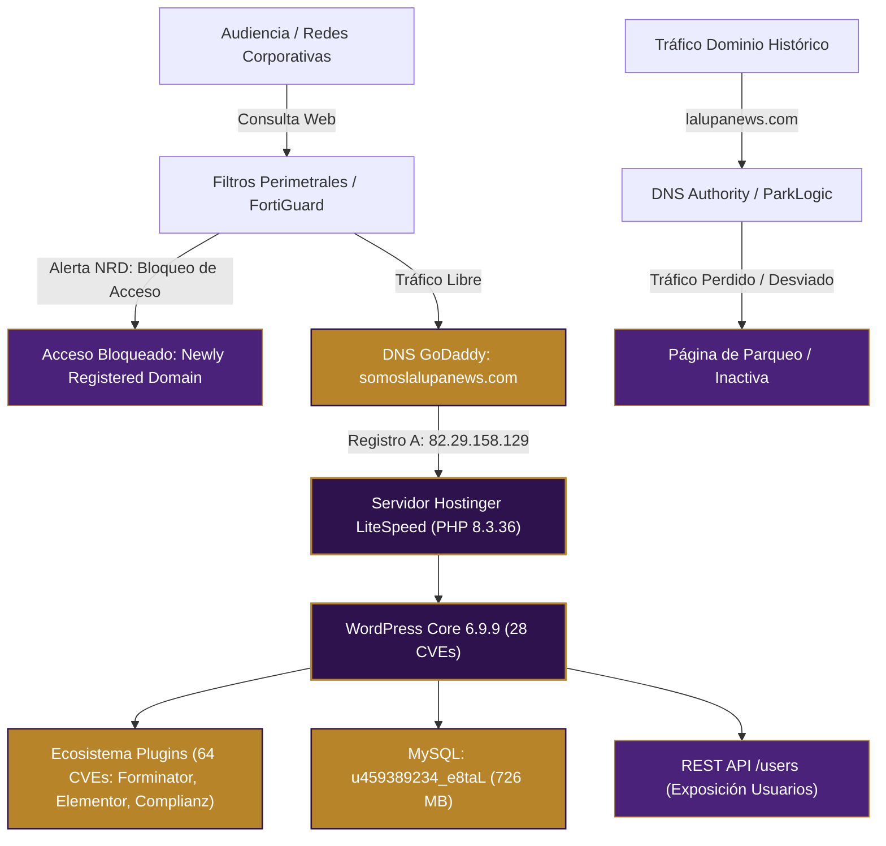

<!-- ========================================== -->
<!-- 1. PORTADA INSTITUCIONAL (COVER PAGE)      -->
<!-- ========================================== -->

**LA LUPA NEWS — ESTRATEGIA DIGITAL Y TECNOLOGÍA**

 

**DICTAMEN TÉCNICO PERICIAL & AUDITORÍA DE CIBERSEGURIDAD**

# AUDITORÍA INTEGRAL DE SEGURIDAD, INFRAESTRUCTURA Y VULNERABILIDADES WEB

  

*Diagnóstico Forense de la Infraestructura en Hostinger, Resolución de Dominios en GoDaddy y Matriz de Parcheo del CMS*

  

**PRESENTADO A:**

## JAVIER FERNÁNDEZ FRANCO
CEO — La Lupa News

  

---

Presentado por: <b>Leonel Salcedo</b> — Dirección y Consultoría Tecnológica 
Fecha de Emisión: Octubre de 2026 | Versión: 1.0 Oficial de Diagnóstico 
Estado: Auditoría Concluida — Listo para Cotización y Plan de Remediación

<!-- ========================================== -->
<!-- 2. ENCABEZADO Y PIE DE PÁGINAS INTERIORES  -->
<!-- ========================================== -->

> **LA LUPA NEWS | Auditoría Integral de Seguridad Web**  
> *Confidencial — Uso Exclusivo de Dirección General y Presidencia*

---

## 1. Resumen Ejecutivo y Diagnóstico Global

El presente dictamen técnico pericial ha sido elaborado por **Leonel Salcedo — Dirección y Consultoría Tecnológica** para la dirección general de **La Lupa News**, encabezada por su CEO **Javier Fernández Franco**.

Tras una inspección no invasiva de la infraestructura de alojamiento en **Hostinger**, la delegación de dominios en **GoDaddy** y el ecosistema del CMS **WordPress**, se ha determinado que el portal se encuentra en un **estado crítico de obsolescencia técnica y vulnerabilidad operativa**, derivado de una prolongada ausencia de mantenimiento, actualizaciones y endurecimiento perimetral (*hardening*).

> [!CAUTION]
> **NIVEL DE AMENAZA GLOBAL: CRÍTICO (ALTO RIESGO DE COMPROMISO)**  
> Se identificaron un total acumulado de **93 vulnerabilidades documentadas en bases de inteligencia (Patchstack/CVE)**:
> - **28 vulnerabilidades en el Core de WordPress** (versión 6.9.9), incluyendo vectores de Inyección SQL (SQLi), Falsificación de Solicitudes (SSRF), Confusión de Manejador en REST API e Inclusión Local de Archivos (LFI) hacia Ejecución Remota de Código (RCE).
> - **64 vulnerabilidades en plugins activos**, destacando brechas de subida arbitraria de archivos y RCE en componentes de formularios y constructores visuales.
> - **1 vulnerabilidad en el tema visual principal**.
> - **Bloqueo activo por firewalls corporativos (FortiGuard / Fortinet)** debido a la juventud del dominio `somoslalupanews.com` (clasificado como *Newly Registered Domain*).
> - **Fuga total de cuentas de usuario** a través de la interfaz REST API pública.

Conforme a las directrices de gobernanza técnica, **no se ha realizado ningún cambio, modificación ni alteración en el código o en los servidores**; este informe constituye la base objetiva para estructurar la cotización de servicios de remediación y modernización integral.

---

## 2. Mapa de Arquitectura, Flujo de Tráfico y Vectores de Riesgo

El siguiente esquema detalla el desacople de dominios, la delegación DNS y los puntos críticos expuestos a incidentes de seguridad o denegación de acceso:

---

## 3. Análisis Forense: Bloqueo de Red y Crisis de Dominios (GoDaddy vs. Hostinger)

### 3.1. Causa Raíz del Bloqueo FortiGuard Intrusion Prevention
En las comprobaciones de acceso móvil y corporativo se evidenció el bloqueo inmediato con el mensaje:
> *"FortiGuard Intrusion Prevention - Access Blocked. Category: Newly Registered Domain. URL: https://somoslalupanews.com/"*

- **Fecha de Registro**: `somoslalupanews.com` fue registrado en **GoDaddy** el **21 de octubre de 2026** (antigüedad menor a 8 días).
- **Mecanismo de Bloqueo**: Los sistemas perimetrales de seguridad corporativa (Fortinet FortiGuard, Palo Alto Networks, Cisco Umbrella, Zscaler) mantienen una lista de reputación estricta para *Newly Registered Domains* (NRD). Todo dominio con menos de 30 días de vida es bloqueado de forma predeterminada para mitigar campañas emergentes de phishing, secuestro o malware.
- **Impacto Directo**: Ejecutivos, patrocinadores comerciales, anunciantes y lectores que intenten ingresar desde redes empresariales, bancarias o de gobierno experimentan el bloqueo inmediato del portal de noticias.

### 3.2. Disociación del Dominio Institucional `lalupanews.com`
- El dominio original `lalupanews.com` posee titularidad vigente hasta septiembre de 2027, pero sus servidores de nombres (`NS`) apuntan a `ns4.dnsauthority.com` y `ns5.dnsauthority.com` (servicio de parqueo de tráfico **ParkLogic / pltraffic7.com**).
- El portal configurado internamente en Hostinger aún conserva **10 enlaces absolutos residuales** apuntando a `lalupanews.com`, lo que genera enlaces rotos o redirecciones imprevistas a servicios publicitarios de parqueo.
- **Acción requerida**: Consolidar la propiedad y redirección 301 de ambas marcas hacia un único dominio canónico unificado y solicitar la recategorización de reputación ante FortiGuard y los principales motores de reputación web.

---

## 4. Matriz de Vulnerabilidades en WordPress Core y Componentes

### 4.1. Obsolescencia del Núcleo (WordPress Core 6.9.9)
El núcleo presenta **28 vulnerabilidades críticas y de severidad alta** sin mitigar:

| Identificador / Vector | Severidad | Descripción del Impacto | Mitigación Oficial |
| :--- | :---: | :--- | :---: |
| **Unauthenticated SQL Injection** | **Crítica** | Permite inyección SQL directa en la base de datos sin requerir inicio de sesión previo. | Versión 7.0.2+ |
| **REST API Batch Handler Confusion** | **Alta** | Confusión en el procesador de lotes de REST API que permite elusión de autenticación. | Versión 7.0.2+ |
| **Reflected XSS to Remote Code Execution** | **Crítica** | Escalada desde Cross-Site Scripting reflejado hacia ejecución remota de comandos en el servidor. | Versión 7.0.3+ |
| **Unauthenticated LFI to RCE** | **Crítica** | Inclusión local de archivos sin credenciales que culmina en control total del sistema. | Versión 7.1.2+ |
| **Author+ File Type Confusion RCE** | **Alta** | Evasión de extensiones en la subida de medios por usuarios con rol de autor. | Versión 7.0.4+ |
| **Sensitive Data Exposure en REST** | **Media** | Fuga de títulos y borradores privados no publicados a través de la API REST. | Versión 7.1.1+ |

*Actualización oficial disponible: v6.9.10 (parche menor de seguridad) y v7.1.3 (versión estable recomendada).*

---

### 4.2. Plugins Críticos Afectados por Brechas de Seguridad (64 CVEs)

De un inventario total de **40 plugins instalados**, **8 plugins esenciales poseen vulnerabilidades severas**:

| Plugin Instalado | Versión Actual | Estado | Vulnerabilidades | Principales Amenazas Registradas |
| :--- | :---: | :---: | :---: | :--- |
| **Forminator** | `1.51.1` | **Activo** | **38** | **Subida arbitraria de archivos**, RCE administrativo, elusión de pago Stripe, escalada de privilegios y robo de datos. |
| **Complianz GDPR/CCPA** | `7.1.6` | **Activo** | **13** | **Inyección de Objetos PHP**, fuga de información sensible, XSS almacenado no autenticado. |
| **Elementor Website Builder** | `3.35.8` | **Activo** | **6** | XSS almacenado vía REST API, Broken Access Control, exposición de parámetros internos. |
| **CMB2** | `2.11.0` | **Activo** | **3** | Corrupción arbitraria de opciones del sistema (`wp_options`), XSS almacenado. |
| **MC4WP: Mailchimp for WP** | `4.12.0` | **Activo** | **2** | XSS almacenado vía mensajes de respuesta de formularios, XSS reflejado. |
| **Elementor Pro** | `3.35.1` | **Activo** | **1** | **Subida arbitraria de archivos (Arbitrary File Upload)** permitiendo ejecución de shells web. |
| **GTM4WP (Google Tag Manager)** | `1.22.3` | **Activo** | **1** | XSS almacenado no autenticado a través de eventos de rastreo. |
| **Tema JNews (News Theme)** | `12.0.4` | **Activo** | **1** | Vulnerabilidad de renderizado en plantillas child/frontend. |

---

## 5. Auditoría de Servidor, PHP y Superficie de Exposición

### 5.1. Fuga de Identidad de Servidor y Parámetros PHP Inseguros
- **Fuga de Versión en Cabeceras HTTP**:
  - `X-Powered-By: PHP/8.3.36` (Expone la versión exacta y revisión del intérprete PHP a cualquier escaneo automatizado).
  - `Server: LiteSpeed` (Divulgación explícita del servidor web).
- **Directivas Inseguras en PHP (`php.ini`)**:
  - `allow_url_fopen: On`: **Habilitado**. Permite la inclusión remota de código si existe una brecha LFI en temas o plugins.
  - `expose_php: On`: **Habilitado**.
  - `session.cookie_secure: Off`: Las cookies de sesión pueden transmitirse sin cifrado en conexiones HTTP no forzadas.
  - `session.cookie_httponly: Off`: Las cookies de sesión son accesibles vía scripts JavaScript (vulnerable a secuestro de sesión mediante ataques XSS).
  - `log_errors: Off`: Deshabilitado. No se registran incidentes ni anomalías técnicas para análisis forense.

### 5.2. Enumeración Masiva de Usuarios por REST API
- **Endpoint**: `https://somoslalupanews.com/wp-json/wp/v2/users`
- **Diagnóstico**: **Abierto al público (HTTP 200)**.
- **Resultado de la Auditoría**: Se descargó exitosamente una estructura de **91.3 KB** que revela los nombres de usuario, identificadores numéricos, enlaces permanentes, roles y slugs de los redactores y administradores del portal. Esto facilita ataques directos de fuerza bruta y *password spraying* al conocer con certeza los nombres de login.

### 5.3. Ausencia Total de Cabeceras de Endurecimiento Web (*Security Headers*)
La evaluación de las cabeceras HTTP arrojó la ausencia de las directivas básicas de la industria:
- ❌ **Falta `Strict-Transport-Security` (HSTS)**: Permite ataques de degradación de cifrado (SSL Stripping).
- ❌ **Falta `X-Frame-Options`**: El portal puede ser embebido en iframes de terceros para ataques de *Clickjacking*.
- ❌ **Falta `X-Content-Type-Options: nosniff`**: Permite a los navegadores interpretar archivos estáticos como scripts ejecutables.
- ❌ **Falta `Referrer-Policy`** y **`Permissions-Policy`**.

### 5.4. Exposición de IP de Origen y Debilidades de Correo en DNS
- **Fuga de IP de Servidor**: En la zona DNS de Hostinger, el registro A de `ftp` apunta directamente a `82.29.158.129`. Esto permite a atacantes eludir proxies de protección o capas de filtrado (como Cloudflare) y dirigir ataques de denegación de servicio (DDoS) directamente al servidor.
- **Políticas de Correo Electrónico**:
  - `_dmarc`: Configurado como `v=DMARC1; p=none`. Modo meramente informativo que no bloquea correos apócrifos, permitiendo que terceros envíen correos electrónicos haciéndose pasar por `@lalupanews.com` o `@somoslalupanews.com`.
  - `SPF`: Configurado con calificador suave `~all` (*softfail*).

---

## 6. Dictamen y Recomendaciones para la Propuesta Económica

Para restablecer la plena operatividad, garantizar la inmunidad ante ataques masivos y habilitar el desbloqueo perimetral ante FortiGuard, se estructuran las siguientes **4 fases técnicas** indispensables para la futura cotización:

### Fase 1: Desbloqueo de Reputación, Saneamiento de Dominios y DNS
1. Apuntar y unificar formalmente los registros DNS de GoDaddy y Hostinger bajo una arquitectura limpia (registro A / CNAME hacia la plataforma correcta).
2. Recuperar o desviar limpiamente el tráfico histórico de `lalupanews.com`.
3. Reemplazo automatizado en base de datos de las 10 URLs residuales rotas.
4. Solicitud formal de recategorización de dominio ante los laboratorios de Fortinet FortiGuard, Palo Alto y Cisco Talos para levantar el veto corporativo.

### Fase 2: Blindaje de Servidor, PHP y Cabeceras HTTP
1. Modificación de directivas en Hostinger: desactivar `allow_url_fopen` y `expose_php`; activar `session.cookie_secure`, `session.cookie_httponly` y habilitar `log_errors`.
2. Supresión perimetral de cabeceras reveladoras (`X-Powered-By`, `Server`).
3. Inyección de Security Headers completos (HSTS, X-Frame-Options: SAMEORIGIN, nosniff, Referrer-Policy, CSP estricto).
4. Ocultamiento de la IP de origen en DNS y endurecimiento de DMARC (`p=quarantine` o `p=reject`) y SPF (`-all`).

### Fase 3: Parcheo, Actualización y Endurecimiento del CMS WordPress
1. Creación de respaldo integral pericial (Archivos + Base de datos MySQL de 726 MB) antes de cualquier intervención.
2. Actualización guiada del Core de WordPress desde la versión 6.9.9 hacia la versión estable validada (7.1.3).
3. Actualización y saneamiento de los 8 plugins vulnerables (Forminator a >= 1.57.3, Complianz a >= 7.5.6, Elementor a >= 4.3.5, Elementor Pro a >= 4.2.2).
4. Reemplazo o eliminación de componentes no mantenidos o redundantes.
5. Verificación de compatibilidad con el tema JNews para evitar disrupciones visuales en la portada.

### Fase 4: Cierre Perimetral de Superficie de Ataque
1. Bloqueo total de la enumeración de usuarios en REST API (`/wp-json/wp/v2/users`) para visitantes anónimos.
2. Cambio de la ruta de acceso administrativo (`/wp-login.php`) y adición de protección contra ataques de fuerza bruta y 2FA para el usuario administrador.
3. Configuración de Cron Jobs a nivel de servidor (crontab de Hostinger) y desactivación de la ejecución pública de `wp-cron.php`.
4. Restricción de acceso directo a archivos sensibles (`readme.html`, `license.txt`).

---

Leonel Salcedo — Dirección y Consultoría Tecnológica | Confidencial — La Lupa News

