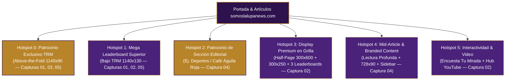

<!-- ========================================== -->
<!-- 1. PORTADA INSTITUCIONAL (COVER PAGE)      -->
<!-- ========================================== -->

**LA LUPA NEWS — ESTRATEGIA DIGITAL Y TECNOLOGÍA**

 

**AUDITORÍA TÉCNICA, EXTRACCIÓN DE MARCA Y CAPTURA VISUAL**

# Auditoría Integral del Portal Somos La Lupa News (`somoslalupanews.com`)

  

*Insumo Base de Identidad Real, Inventario Visual, Widget TRM y Mapa de Espacios Publicitarios para el Pitch Comercial e Inversionistas*

  

**PRESENTADO A:**

## JAVIER FERNÁNDEZ FRANCO
CEO — La Lupa News

  

---

Presentado por: <b>Leonel Salcedo</b> | Consultoría Tecnológica & Transformación Digital 
Fecha: Noviembre de 2026 | Estado: Versión Oficial Aprobada

<!-- ========================================== -->
<!-- 2. ENCABEZADO INTERIOR                     -->
<!-- ========================================== -->

> **LA LUPA NEWS | Auditoría de Scraping, Marca y Captura Visual (`NS-LLN-AUD-002`)**  
> *Confidencial — Uso Exclusivo de Dirección General y Equipo de Diseño del Pitch*

| Campo de Control ISO 9001 (Cláusula 7.5) | Valor Canónico |
| :--- | :--- |
| **Código de Documento** | `NS-LLN-AUD-002` |
| **Versión SemVer** | `1.0.0` |
| **Fecha de Emisión / Revisión** | `2026-11-23` |
| **Estado** | `Vigente` |
| **Autor / Aprobador** | `Leonel Salcedo (Dirección y Consultoría Tecnológica / HITL Lead)` |
| **Marcos ISO Aplicables** | `ISO 9001:2015 (Cl. 7.5)` · `ISO/IEC 27001:2022` · `ISO/IEC 25010:2023` |

---

> [!IMPORTANT]
> **DIRECTRIZ CRÍTICA DE IDENTIDAD VISUAL PARA EL PITCH HTML INTERACTIVO**  
> Este documento interno de consultoría sigue la normativa documental de marca personal (**Morado `#2d124d` + Dorado `#b8842a`**). Sin embargo, el **Pitch Comercial e Inversionistas en HTML interactivo** orientado al mercado **DEBE emplear exclusivamente la identidad visual real extraída de `somoslalupanews.com`** (Azul Marino Institucional `#052962`, Azul Editorial `#346E9B`, Terracota Editorial `#AA5959`, Dorado Oliva `#B9AF07`, fondos `#FFFFFF`/`#F7F7F7` y los logotipos oficiales almacenados en `assets/branding/logos/`). **Jamás** aplicar morado/dorado al pitch de cara a anunciantes o inversionistas.

---

## 1. Resumen Ejecutivo de la Auditoría

Se ejecutó un análisis estructural, extracción de diseño computado (CSS/Elementor/JNews), auditoría vía API REST de WordPress (`wp-json/wp/v2`) y captura visual en alta resolución (escritorio `1440×900 @2x`, página completa, widget TRM en contexto, vista de artículo y móvil `390×844 @2x`) sobre **`https://somoslalupanews.com`** con fecha de corte **19 de noviembre de 2026**.

### Hallazgos Clave para la Narrativa Comercial

- **Activo Editorial Robusto (4.583 publicaciones reales)**: El portal no es un prototipo vacío; posee un archivo periodístico verificado de **4.583 artículos publicados** entre el **22 de octubre de 2024** y el **20 de marzo de 2026**, con fuerte peso en **Colombia (2.312)**, **Mundo (668)**, **Deportes (657)** y **Poder/Política (591)**.
- **Estado de Latencia Verificado (~8 meses)**: La última publicación registrada data del **20 de marzo de 2026 a las 18:32** (*"Aterrizaje forzoso en zona rural del Valle deja dos heridos"*). Esto respalda con total transparencia la tesis comercial del pitch: una plataforma madura y lista para reactivación inmediata mediante estrategia editorial y marketing digital inteligente.
- **Widget TRM Vivo y Actualizado Hoy (Joya Comercial)**: A diferencia del flujo de noticias pausado, el **widget financiero de la TRM (`.fmp-trm-summary-card`) opera en tiempo real**, ubicado *above-the-fold* justo debajo del menú principal (`y = 247 px`, `1140 × 90 px`), mostrando al **19 de noviembre de 2026**: **TRM HOY `$3,327 COP`** | **TRM AYER `$3,310`** | **TRM ANTEAYER `$3,317`**.
- **Prueba Real de Comercialización Previa (Social Proof)**: El portal exhibe inventario publicitario real ya estructurado, incluyendo pauta display multi-formato de **Súper Astro WEB** (6 posiciones activas en portada) y patrocinio editorial de sección **"Patrocinado por Café Águila Roja"** en artículos de **Deportes**, además de promoción cruzada con el canal **"Te Las Canto — Live"** vinculado al ecosistema de **Javier Fernández Franco (`@elcantantedelgol.oficial`)**.
- **Identidad Visual Sólida y Diferenciada**: El portal cuenta con una identidad periodística clásica y confiable basada en **Azul Marino Institucional (`#052962`)**, **Azul Editorial (`#346E9B`)**, **Rojo Terracota (`#AA5959`)** y **Dorado Oliva (`#B9AF07`)**, acompañada de un logotipo distintivo donde la letra "P" de *LUPA* se construye con una lupa y un ojo en alta resolución (`2000 × 1549 px`).

---

## 2. Identidad Editorial, Arquitectura y Ecosistema Técnico

### 2.1. Identidad Institucional Extraída del Portal

| Atributo | Valor Verificado en `somoslalupanews.com` |
| :--- | :--- |
| **Nombre Comercial** | La Lupa News (Portal: Somos La Lupa News) |
| **Dominio Activo** | `https://somoslalupanews.com/` (HTTP 200 OK, HTTPS válido) |
| **Propuesta / Misión Oficial** | *"Somos un portal informativo digital, donde el buen periodismo es el insumo principal para contar cada historia, noticia, crónica, reportaje, podcast o entrevista sobre el acontecer diario en Colombia y en el mundo."* |
| **Dirección Física (Footer)** | Calle 127 #16A-76, oficina 402, Bogotá, Colombia |
| **Correo Visible (Footer)** | `lalupanewsco@gmail.com` |
| **Stack Tecnológico** | WordPress `6.9.9` + Tema editorial **JNews** + **Elementor `3.35.8` & Elementor Pro** |
| **Rendimiento y SEO** | **LiteSpeed Cache** (Hostinger), **Yoast SEO**, **AMP**, **Image Optimizer** |
| **Herramientas de Marketing/UX** | **HubSpot** (`leadin/v1`), **Mailchimp for WP** (`mc4wp/v1`), **Forminator** (encuestas interactivas), **Complianz** (privacidad), **Financial Market Plugin (`fmp/v1`)** para TRM |

### 2.2. Navegación Principal y Distribución del Archivo Editorial (4.583 Artículos)

**Barra de navegación superior activa**: `Colombia` | `Política` *(desplegable)* | `Deportes` | `Mundo` | `Historias` | `Música` | `Opinión` + botón destacado **`En Vivo`** y buscador en barra superior.

| Categoría Editorial | Slug | Artículos Publicados | Participación Aprox. | Potencial Comercial / Patrocinio |
| :--- | :--- | :---: | :---: | :--- |
| **Colombia** | `colombia` | **2.312** | 50,4% | Masivo / Consumo, telecomunicaciones, retail, gobierno |
| **Mundo** | `mundo` | **668** | 14,6% | Aerolíneas, turismo, remesas, fintech internacional |
| **Deportes** | `deportes` | **657** | 14,3% | Casas de apuestas, bebidas, café, automotor *(ej. Café Águila Roja)* |
| **Poder (Política)** | `poder` | **591** | 12,9% | Corporativo, gremios, consultoras, asuntos públicos |
| **Historias** | `historias` | **126** | 2,7% | Branded content, crónicas patrocinadas, lifestyle |
| **Portada** | `news` | **110** | 2,4% | Destacados de alto impacto *above-the-fold* |
| **Opinión** | `opinion` | **71** | 1,5% | Liderazgo de pensamiento, universidades, banca |
| **Economía** | `economia` | **34** | 0,7% | Bancos, fintech, aseguradoras, inversión *(sinergia directa con TRM)* |
| **Negocios** | `negocios` | **27** | 0,6% | B2B, SaaS, constructoras, logística |
| **Entretenimiento & Música** | `entretenimiento` / `musica` | **43** | 0,9% | Conciertos, streaming, ticketeras, marcas juveniles |
| **Estilo de Vida, Cultura, Otros** | varios (`cultura`, `viajes_turismo`, `comida`, `tecnologia`, `ciencia`, `salud_fitness`) | **60** | 1,3% | Verticales listas para activar contenido patrocinado |

### 2.3. Cronología de Publicación Verificada

- **Primera publicación registrada**: `2024-10-22` — *"En medio de operativo la Infantería de Marina recuperó 107 especies de fauna silvestre"*.
- **Últimas publicaciones registradas (todas el `2026-03-20`)**:
  1. `2026-03-20 18:32` — *Aterrizaje forzoso en zona rural del Valle deja dos heridos*
  2. `2026-03-20 18:12` — *Dueño del perro que fue arrojado desde un piso 25 en Bogotá señala a su arrendatario como responsable del crimen*
  3. `2026-03-20 18:06` — *Autoridades investigan celulares en posesión de Epa Colombia dentro de la Escuela de Carabineros*
  4. `2026-03-20 18:01` — *La Selección Colombia ya definió rival para despedirse de su hinchada antes de viajar al Mundial 2026*
  5. `2026-03-20 06:35` — *“Quieren debilitar mi gobierno”: presidente Petro ante destitución de Cielo Rusinque como superintendente de Industria y Comercio* (actual titular principal de portada).
- **Ritmo previo a la pausa**: Las últimas **100 notas** se concentraron íntegramente en **marzo de 2026** (más de 5 notas diarias), demostrando una maquinaria editorial capaz de producir volumen constante tan pronto se reactive.

---

## 3. Identidad Visual Real Extraída (Tokens para el Pitch HTML)

Todos los tokens se guardaron de forma estructurada en [`assets/branding/brand_tokens.json`](../../assets/branding/brand_tokens.json) a partir de las variables computadas de Elementor Global Kit (`--e-global-*`) y JNews (`--j-*`).

### 3.1. Paleta Cromática Oficial de `somoslalupanews.com`

| Token / Rol Visual | Código HEX | RGB Computado | Variable CSS Origen | Uso Real en el Portal |
| :--- | :---: | :--- | :--- | :--- |
| **Primario — Azul Marino Institucional** | `#052962` | `rgb(5, 41, 98)` | `--e-global-color-primary` | Header principal, barra de navegación, footer y logotipo oficial |
| **Primario Oscuro — Barra Superior** | `#041F4A` | `rgb(4, 31, 74)` | Elementor Topbar | Barra superior de redes sociales, buscador y acceso *En Vivo* |
| **Tinta Principal — Azul Noche** | `#02132F` | `rgb(2, 19, 47)` | `--e-global-color-text` / `--j-alt-color` | Texto de cuerpo editorial y alto contraste |
| **Azul Editorial — Titulares y TRM** | `#346E9B` | `rgb(52, 110, 155)` | `--j-body-color` / `--j-entry-link-color` | Titulares de portada, cifras de la TRM (`$3,327 COP`) y enlaces |
| **Acento Editorial — Rojo Terracota** | `#AA5959` | `rgb(170, 89, 89)` | `--e-global-color-accent` / `--j-accent-color` | H1 de artículos, etiquetas `TRM HOY`, líneas de sección y acentos |
| **Secundario — Dorado Oliva** | `#B9AF07` | `rgb(185, 175, 7)` | `--e-global-color-secondary` | Botones de acción y disparador del menú móvil |
| **Gris Pizarra Azulado** | `#2E3C46` | `rgb(46, 60, 70)` | `--j-heading-color` | Encabezados secundarios y subtítulos |
| **Fondo Principal — Blanco Puro** | `#FFFFFF` | `rgb(255, 255, 255)` | `body` | Lienzo principal de lectura y tarjeta TRM |
| **Superficie Secundaria — Gris Perla** | `#F7F7F7` | `rgb(247, 247, 247)` | Módulos JNews | Tarjetas editoriales, cajones de sidebar y degradados suaves |
| **Bordes y Metadatos** | `#DEE2E6` / `#69727D` | `rgb(222,226,230)` / `rgb(105,114,125)` | TRM / Metadatos | Bordes de contenedor TRM, breadcrumbs y fechas (`#2B2F33`) |

### 3.2. Tipografía Oficial del Portal y Equivalencia Web para el Pitch

| Nivel Tipográfico | Familia Definida en el Portal | Pesos | Uso Editorial | Equivalente Google Fonts para Pitch HTML |
| :--- | :--- | :---: | :--- | :--- |
| **Display / Titulares** | `MFB Oldstyle` / `MFB Oldstyle Bold` | 700, 800 | Titulares H1/H2/H3, cifras TRM, menú principal | **`Playfair Display`** o **`Libre Baskerville`** (serif editorial clásica de alto contraste) |
| **Serif Secundaria** | `LT Superior Serif` | 400, 700, 800 | Entradillas y destacados editoriales | **`Source Serif 4`** o **`Merriweather`** |
| **Cuerpo y UI Sans** | `Funnel Sans` | 400, 800 | Cuerpo de lectura, etiquetas, navegación y controles | **`Funnel Sans`** *(disponible directamente en Google Fonts)* |
| **Display Complementario** | `LT Museum` | 600, MediumItalic | Elementos de sección y encabezados especiales | Combinación con `Funnel Sans` Semibold/Bold |

---

## 4. Auditoría Especial del Widget Financiero TRM (Requisito Prioritario)

El widget de la **Tasa Representativa del Mercado (TRM)** es uno de los mayores diferenciadores de **Somos La Lupa News** frente a medios dependientes exclusivamente de redes sociales, al generar **hábito de consulta diaria** en audiencias de alto poder adquisitivo (empresarios, viajeros, inversionistas, importadores y lectores financieros).

- **Implementación técnica**: Generado por el plugin propio `fmp/v1` (*Financial Market Plugin*) en el contenedor `.fmp-trm-summary-card` (`border: 1px solid #dee2e6; border-radius: 5px;`).
- **Posición de privilegio**:
  - **Escritorio (`1440 px`)**: `x = 150 px`, `y = 247 px`, dimensiones `1140 × 90 px` — **100% visible al primer vistazo (*above-the-fold*)**, justo entre la barra de navegación azul marino y el banner leaderboard superior.
  - **Móvil (`390 px`)**: `x = 10 px`, `y = 168 px`, dimensiones `370 × 53 px` — diseño responsivo limpio en 3 columnas legibles sin desbordamiento horizontal.
- **Datos en vivo verificados (19 de noviembre de 2026)**:
  - **TRM HOY**: **`$3,327 COP`** *(19 noviembre, 2026)* — Etiqueta `#AA5959`, cifra destacada `#346E9B`, fecha `#2B2F33`.
  - **TRM AYER**: **`$3,310`** *(18 noviembre, 2026)*.
  - **TRM ANTEAYER**: **`$3,317`** *(14 noviembre, 2026)*.
- **Oportunidad de Monetización Directa (*Crown Jewel*)**: Espacios contiguos o *co-branding* tipo **"Indicador TRM presentado por [Banco / Fintech / Casa de Cambio / Aerolínea]"** con 100% de *viewability* tanto en escritorio como en móvil y cero ceguera de banners (*banner blindness*).

---

## 5. Canales Sociales, Formularios e Interactividad Encontrados

### 5.1. Redes Sociales Vinculadas en el Portal

| Red Social | URL Exacta Encontrada | Ubicación en el Sitio | Observaciones |
| :--- | :--- | :--- | :--- |
| **YouTube (Portal)** | `https://www.youtube.com/@LaLupaNews` | Header y Footer | Canal oficial del medio + módulo "LA LUPA NEWS EN YOUTUBE" en portada |
| **YouTube (Ecosistema CEO)** | `https://www.youtube.com/@elcantantedelgol.oficial` | Cuerpo (Sidebar Promo *Te Las Canto Live*) | Vinculado al programa de Javier Fernández Franco (*El Cantante del Gol*) |
| **Instagram** | `https://www.instagram.com/lalupanewsco/` | Header y Footer | Handle oficial unificado `@lalupanewsco` |
| **X (Twitter)** | `https://x.com/lalupanewsco` | Header, Cuerpo y Footer | Handle oficial `@lalupanewsco` (también en `meta twitter:site`) |
| **TikTok** | `https://www.tiktok.com/@lalupanews` | Header y Footer | Canal de formato corto vertical |
| **Facebook** | `https://www.facebook.com/profile.php?id=61572383767685` | Header y Footer | Perfil con ID numérico (pendiente URL amigable; existe además un ícono suelto `http://facebook.com/` sin perfil) |
| **LinkedIn** | `https://www.linkedin.com/in/la-lupa-news-504432338/` | Footer | Perfil personal (recomendado migrar a Company Page para ventas B2B) |

### 5.2. Formularios, Encuestas y Puntos de Contacto

- **Encuesta Interactiva en Portada (*Forminator Poll #3332*)**: Sección **"TU MIRADA EN LA LUPA NEWS"** (ejemplo activo: encuesta de opinión política en sidebar). Permite activar encuestas patrocinadas o pulsos de marca.
- **Newsletter / CRM**: Aunque los plugins **Mailchimp (`mc4wp`)** y **HubSpot (`leadin`)** están instalados en WordPress, **no hay actualmente un formulario visible de suscripción a Newsletter** en portada ni en el footer (oportunidad inmediata de captura de audiencia propia / *first-party data*).
- **Enlaces institucionales ("Nosotros", "Publica con Nosotros", "Políticas & Privacidad", "Contáctanos")**: Presentes en el pre-footer y footer, actualmente apuntan a `#` (requieren creación de páginas dedicadas durante la fase de reactivación).

---

## 6. Diagnóstico Técnico Honesto (Quick-Wins de Reactivación)

Durante la auditoría se detectaron **5 hallazgos técnicos reales** (derivados de la transición del dominio antiguo `lalupanews.com` hacia `somoslalupanews.com`), todos de corrección rápida y alto impacto antes de lanzar campañas pagas:

1. **Rutas de fuentes `@font-face` apuntando al dominio antiguo**: Elementor/JNews aún solicitan `MFBOldstyle-Bold.woff`, `FunnelSans-Regular.ttf`, `LTSuperiorSerif-Regular.woff` y `LTMuseum-Bold.ttf` desde `lalupanews.com` (error `ERR_HTTP2_PROTOCOL_ERROR`). **Verificación positiva**: los 4 archivos **ya existen y responden HTTP 200** en `somoslalupanews.com/wp-content/uploads/...`; un *Search & Replace* en base de datos + regeneración de CSS de Elementor restaura la tipografía nativa en minutos.
2. **Imagen rota en encuesta Forminator y `og:image` legado**: La imagen de la encuesta (`Vicepresidenta-1024x709.jpeg`) y el `og:image` de portada (`betplay.webp`) apuntan a `lalupanews.com`.
3. **Plantillas de contacto y legales sin personalizar en footer**: El texto muestra `Email: lalupanewsco@gmail.com`, pero su enlace `href` conserva `mailto:contact@mysite.com`; los enlaces *Correcciones*, *Privacidad*, *Cookies* y *Términos y Condiciones* apuntan a URLs de plantilla de `library.elementor.com`.
4. **Dos slots 728×90 en artículos apuntando a `localhost`**: En la plantilla de artículo de JNews existen dos bloques publicitarios configurados con placeholder `http://localhost/lalupanews/wp-content/uploads/2024/11/ad_728x90.png` — lo cual confirma que el espacio técnico mid-article ya existe y solo requiere asignar creativos reales o código de servidor de anuncios.
5. **LiteSpeed JS Delay sobre miniaturas `lazyload`**: El retraso de JavaScript de LiteSpeed mantiene `lazysizes` en pausa hasta detectar interacción del usuario (`mousemove`/`scroll`), lo que puede demorar el pintado inicial (*LCP*) en la fotografía principal de portada; basta con excluir la imagen *hero* (*above-the-fold*) del lazy-loading.

---

## 7. Mapa de Hotspots Publicitarios sobre Capturas Reales

El siguiente mapa conecta cada espacio comercial rentable del portal con su ubicación exacta en las capturas verificadas de `assets/captures/`, listo para alimentar la sección interactiva de **"Espacios de Pauta y Patrocinio"** del Pitch HTML:

| ID Hotspot | Nombre Comercial del Espacio | Formato / Ubicación Exacta | Evidencia en Captura | Tipo de Anunciante Ideal |
| :---: | :--- | :--- | :--- | :--- |
| **H-00** | **Patrocinio Exclusivo Widget TRM** | Integración *co-branded* en módulo `.fmp-trm-summary-card` (`1140×90` desktop / `370×53` móvil, `y=247 px`) | `03_trm_widget.png`, `01_portada_desktop.png`, `05_portada_mobile.png` | Bancos, fintech, casas de cambio, remesas, aerolíneas, aseguradoras |
| **H-01** | **Leaderboard Premium de Portada** | Banner horizontal de alto impacto inmediatamente debajo del TRM (actualmente activo con *Súper Astro WEB*) | `01_portada_desktop.png`, `05_portada_mobile.png` | Consumo masivo, entretenimiento, lanzamientos nacionales |
| **H-02** | **Patrocinio de Sección / Vertical** | Sello **"Patrocinado por [Marca]"** en cabecera de artículos de categoría (ya validado con *Café Águila Roja* en Deportes) | `04_articulo_o_seccion.png` | Marcas afines a Deportes, Economía, Política, Música o Viajes |
| **H-03** | **Skyscraper / Half-Page Sidebar** | Formato vertical `300×600 px` junto al bloque editorial central (actualmente validado con *Súper Astro WEB*) | `02_portada_full.png` | Inmobiliarias, vehículos, educación superior, retail |
| **H-04** | **Banners Intermedios & Pre-Footer** | 3 franjas horizontales de separación entre bloques (*Deportes*, *Más Noticias* y *Pre-Footer*) + `300×250` lateral | `02_portada_full.png` | Campañas de recordación de marca y retargeting |
| **H-05** | **Mid-Article & Branded Content** | Inserción nativa dentro de la lectura del artículo + espacios `728×90` y columna lateral *"Últimas Noticias / Tendencia"* | `04_articulo_o_seccion.png` | Publinotas, historias de marca, lanzamientos B2B y SEO editorial |
| **H-06** | **Encuesta Patrocinada & Video Hub** | Módulo *"Tu Mirada en La Lupa News"* + vitrina *"La Lupa News en YouTube"* + promo lateral *En Vivo* | `02_portada_full.png` | Investigación de opinión, patrocinadores de shows en vivo y podcasts |

---

## 8. Inventario Verificado de Activos y Capturas

Todos los archivos han sido descargados/capturados en alta resolución y **verificados visualmente uno por uno** para garantizar nitidez, carga completa de fotografías editoriales y ausencia de pantallas en blanco, errores 404 o bloqueos de cookies.

### 8.1. Activos Oficiales de Marca (`assets/branding/`)

| Archivo | Dimensiones | Tamaño | Verificación Visual y Uso Recomendado |
| :--- | :---: | :---: | :--- |
| [`assets/branding/logos/Logo 2.png`](../../assets/branding/logos/Logo%202.png) | `2000 × 1549 px` | 167 KB | ✅ Verificado. Logotipo oficial blanco sobre azul `#052962` (uso en header/hero/footer oscuros del Pitch). |
| [`assets/branding/logos/Logo 1.png`](../../assets/branding/logos/Logo%201.png) | `2000 × 1549 px` | 202 KB | ✅ Verificado. Logotipo oficial azul `#052962` sobre fondo transparente (uso sobre fondos claros/blancos). |
| [`assets/branding/logos/Imago favi2.png`](../../assets/branding/logos/Imago%20favi2.png) | `2000 × 2000 px` | 93 KB | ✅ Verificado. Isotipo (ojo en lupa) blanco transparente para badges y fondos oscuros. |
| [`assets/branding/logos/Imago 1.png`](../../assets/branding/logos/Imago%201.png) | `2000 × 2000 px` | 289 KB | ✅ Verificado. Isotipo (ojo en lupa) azul `#052962` transparente para fondos claros. |
| [`assets/branding/logos/favicon.png`](../../assets/branding/logos/favicon.png) | `300 × 300 px` | 11 KB | ✅ Verificado. Favicon oficial activo en el portal (`Imago-favi2-300x300.png`). |
| [`assets/branding/brand_tokens.json`](../../assets/branding/brand_tokens.json) | JSON | — | ✅ Verificado. Tokens de colores HEX/RGB, tipografía, TRM, redes sociales y archivo editorial. |

### 8.2. Capturas de Pantalla en Alta Resolución (`assets/captures/`)

| Archivo | Dimensiones | Viewport / Escala | Contenido Verificado Visualmente |
| :--- | :---: | :---: | :--- |
| [`assets/captures/01_portada_desktop.png`](../../assets/captures/01_portada_desktop.png) | `2880 × 1800 px` | `1440×900 @2x` | ✅ Header azul marino, logo, menú principal, widget TRM vivo (`$3,327 COP`), banner Súper Astro, titular principal + foto y columna *Destacadas*. |
| [`assets/captures/02_portada_full.png`](../../assets/captures/02_portada_full.png) | `1440 × 5043 px` | `1440×full @1x` | ✅ Grilla editorial completa (Portada, Destacadas, Lo Nuevo, Deportes, Más Noticias, Encuesta, YouTube, Otras Noticias, Footer) con 45/46 imágenes cargadas y 7 espacios publicitarios visibles. |
| [`assets/captures/03_trm_widget.png`](../../assets/captures/03_trm_widget.png) | `2880 × 550 px` | Recorte `@2x` en contexto | ✅ Enmarque limpio de la navegación institucional azul marino + tarjeta **TRM HOY `$3,327 COP` / TRM AYER `$3,310` / TRM ANTEAYER `$3,317`** (19 nov 2026) sin recortes residuales. |
| [`assets/captures/04_articulo_o_seccion.png`](../../assets/captures/04_articulo_o_seccion.png) | `2880 × 2700 px` | `1440×1350 @2x` | ✅ Artículo real de *Deportes* (Selección Colombia Mundial 2026) con sello **"Patrocinado por Café Águila Roja"**, titular `#AA5959`, fotografía principal nítida, botones de compartir, cuerpo de lectura y sidebar con miniaturas cargadas. |
| [`assets/captures/05_portada_mobile.png`](../../assets/captures/05_portada_mobile.png) | `780 × 1688 px` | `390×844 @2x` | ✅ Vista móvil limpia y responsiva: barra social, header azul marino con botón `#B9AF07`, widget TRM de 3 columnas perfectamente legible, banner superior, noticia principal y sección *Lo Nuevo*. |

---

Leonel Salcedo — Dirección y Consultoría Tecnológica | Confidencial — La Lupa News

