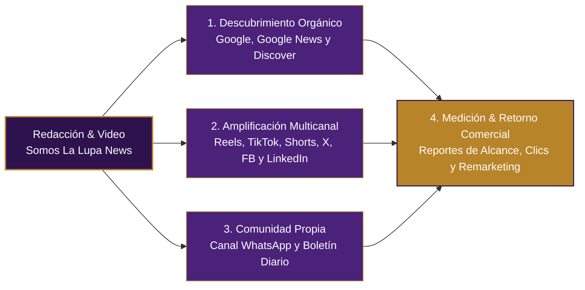
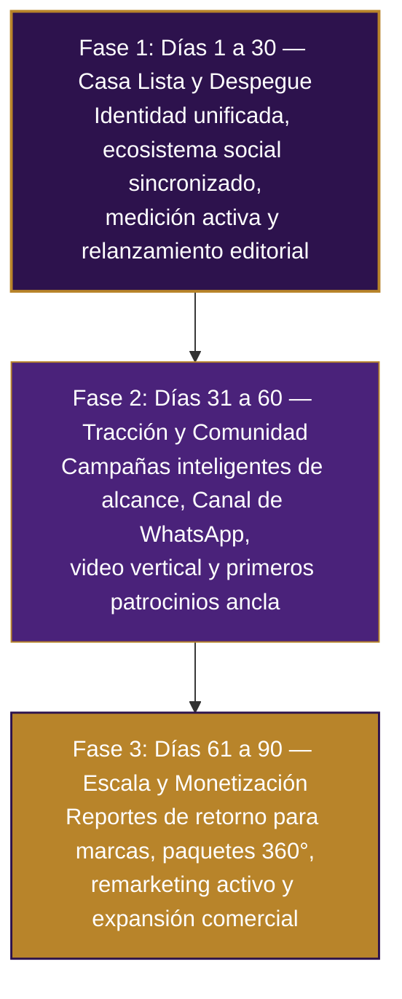

##### LA LUPA NEWS — ESTRATEGIA DIGITAL Y TECNOLOGÍA

### Auditoría OSINT, Huella Digital y Ecosistema de Redes Sociales

# Diagnóstico Integral de Presencia Digital y Hoja de Ruta de Reactivación Comercial

  

*Proyecto: Pitch Comercial para Anunciantes e Inversores — Somos La Lupa News (`somoslalupanews.com`)*

 

**PRESENTADO A**

## Javier Fernández Franco
**CEO — La Lupa News**

 

Presentado por: **Leonel Salcedo** | Consultoría Tecnológica & Transformación Digital  
Fecha: Noviembre 2026 | Estado: Documento de Investigación y Estrategia (Uso Interno HITL + Reencuadre Comercial)

---

> **Encabezado Documental**: `LA LUPA NEWS | Auditoría OSINT y Ecosistema Social (NS-LLN-AUD-003)`  
> **Pie de Página Institucional**: `Leonel Salcedo — Dirección y Consultoría Tecnológica | Confidencial — La Lupa News`  
> **Paleta Oficial Aplicada**: Morado Marca Personal (`#2d124d`), Dorado Institucional (`#b8842a`), Texto Principal (`#222222`), Metadatos (`#777777`).  
> **Fecha de Recolección Factual (OSINT)**: 19 de noviembre de 2026.

| Campo de Control ISO 9001 (Cláusula 7.5) | Valor Canónico |
| :--- | :--- |
| **Código de Documento** | `NS-LLN-AUD-003` |
| **Versión SemVer** | `1.0.0` |
| **Fecha de Emisión / Revisión** | `2026-11-23` |
| **Estado** | `Vigente` |
| **Autor / Aprobador** | `Leonel Salcedo (Dirección y Consultoría Tecnológica / HITL Lead)` |
| **Marcos ISO Aplicables** | `ISO 9001:2015 (Cl. 7.5)` · `ISO/IEC 27001:2022` · `ISO/IEC 42001:2023` |

---

## 1. Resumen Ejecutivo y Estructura del Informe
---

El presente documento consolida la investigación **OSINT (Open Source Intelligence)** y la auditoría de huella web, infraestructura pública, posicionamiento orgánico y ecosistema de redes sociales del portal informativo colombiano **Somos La Lupa News** (`https://somoslalupanews.com`), liderado por su CEO **Javier Fernández Franco**.

Para garantizar rigor absoluto en la toma de decisiones internas sin comprometer la fuerza persuasiva de la presentación comercial, este informe se divide en **dos bloques claramente diferenciados**:

1. **Parte I — Diagnóstico Interno Honesto (Para Revisión HITL de Leonel Salcedo)**: Hallazgos estrictamente verificables extraídos directamente del dominio, registros RDAP/DNS, API pública de WordPress, sitemaps, canales oficiales y búsquedas abiertas. Identifica brechas técnicas, inactividad reciente, el evento crítico del dominio heredado (`lalupanews.com`), métricas sin verificación pública y el filtro exhaustivo de homónimos para evitar contaminación de datos.
2. **Parte II — Reencuadre Comercial & Ejecutivo (Para el Pitch a Anunciantes e Inversores)**: Traducción estratégica de los activos reales de la marca en una narrativa moderna, positiva, libre de jerga técnica y orientada a retorno de inversión (ROI), diseñada para vender pauta publicitaria y sustentar una tesis sólida de reactivación ante potenciales inversores.

> [!IMPORTANT]
> **Política de Rigor Factual (Cero Métricas Inventadas)**: Cada cifra de artículos, fechas de publicación, suscriptores o registros DNS reportada en este documento fue verificada directamente el **19 de noviembre de 2026**. En las plataformas sociales que restringen datos públicos sin sesión iniciada (Instagram, Facebook, X, TikTok y LinkedIn), las métricas se marcan explícitamente como **«No verificable públicamente (requiere validación HITL con accesos del cliente)»**.

---

# PARTE I — DIAGNÓSTICO INTERNO HONESTO (PARA HITL DE LEONEL SALCEDO)
---

## 2. Huella Web, Infraestructura Pública y Hallazgo Crítico de Dominio
---

### 2.1. Auditoría RDAP, DNS e Infraestructura de `somoslalupanews.com`

La inspección pública de registros RDAP (Verisign / RIPE) y DNS del dominio activo revela una transición reciente de dominio que explica el contraste entre el amplio historial de artículos del portal y la juventud del dominio actual:

| Parámetro Público | Valor Verificado (19 Nov 2026) | Implicación Estratégica / Operativa |
| :--- | :--- | :--- |
| **Dominio Activo** | `somoslalupanews.com` | Operativo (HTTP 200), SSL válido, `www` apunta vía CNAME a raíz. |
| **Registrador (RDAP)** | **GoDaddy.com, LLC** (IANA ID 146) | `NS25.DOMAINCONTROL.COM` / `NS26.DOMAINCONTROL.COM`. |
| **Fecha de Registro** | **21 de octubre de 2026** (`2026-10-21T19:33:08Z`) | Dominio con **menos de 1 mes de antigüedad**; expira el `2027-10-21`. |
| **DNSSEC** | `delegationSigned: false` | Sin firma DNSSEC activada. |
| **Servidor / Hosting** | IP `82.29.158.129` (**HOSTINGER-HOSTING**, EE. UU.) | Servidor **LiteSpeed** con **PHP 8.3.37**. |
| **CMS y Constructor** | **WordPress 6.9.9** + **Elementor 3.35.8** + Tema **JNews** | Stack periodístico estándar y escalable; incluye caché LiteSpeed. |
| **Registros MX / SPF** | **Ausentes** (sin MX ni TXT SPF en raíz) | No existe correo corporativo `@somoslalupanews.com` configurado. |
| **Registro DMARC** | `v=DMARC1; p=quarantine; rua=mailto:dmarc_rua@onsecureserver.net` | Política por defecto de GoDaddy. |
| **Archivos Estándar** | `robots.txt` (200), `sitemap_index.xml` (200), `feed/` (200) | **`news-sitemap.xml` (404)**, **`ads.txt` (404)**, **`app-ads.txt` (404)**. |

### 2.2. Hallazgo Crítico: Pérdida del Dominio Heredado (`lalupanews.com`) y Referencias Rotas

> [!CAUTION]
> **Riesgo Técnico y de Seguridad de Marca (Uso Interno Exclusivo)**: La auditoría RDAP confirmó que el dominio histórico original **`lalupanews.com`** expiró y fue registrado el **13 de septiembre de 2026** por **DropCatch.com 701 LLC / NameBright.com** (operador de captura/subasta de dominios vencidos; actualmente sin sitio activo). Treinta y ocho días después (**21 de octubre de 2026**), el equipo registró `somoslalupanews.com` y restauró el respaldo completo de WordPress.

Consecuencias detectadas directamente en el código HTML actual de `somoslalupanews.com`:

1. **11 referencias activas en la portada (y 9 en cada artículo)** todavía apuntan al dominio perdido `lalupanews.com`, incluyendo:
   - **`og:image` de la portada**: apunta a `https://www.lalupanews.com/wp-content/uploads/2024/11/betplay.webp` (imagen rota de una pauta de BetPlay de noviembre de 2024). Cuando alguien comparte `somoslalupanews.com` en WhatsApp, X o LinkedIn, la vista previa se rompe.
   - **6 archivos de fuentes tipográficas y 2 hojas CSS de Elementor** (`FunnelSans-Regular.ttf`, `LTMuseum-Bold.ttf`, `LTMuseum-MediumItalic.ttf`, `LTSuperiorSerif-Bold.woff`, `MFBOldstyle-Bold.woff`, `LTSuperiorSerif-Regular.woff`, `montserrat.css`, `poppins.css`) siguen cargándose desde `https://lalupanews.com/...`. Si un tercero adquiere `lalupanews.com`, podría degradar o inyectar recursos externos en el portal.
   - Un enlace directo remanente a `https://lalupanews.com/` y al menos una imagen de portada (`Vicepresidenta-1024x709.jpeg`).
2. **Reinicialización de Autoridad SEO (Domain Authority)**: Al perder `lalupanews.com` sin redirecciones `301`, `somoslalupanews.com` arrancó desde cero su autoridad de dominio en Google el 21 de octubre de 2026. Las búsquedas externas (`"somoslalupanews.com" -site:somoslalupanews.com`) todavía no muestran backlinks de prensa ni menciones en directorios (SembraMedia, FLIP, etc.).

### 2.3. Cadencia Editorial Histórica y Señales de Inactividad (Dormancy)

La consulta directa a los 5 sitemaps de Yoast SEO y a la API pública de WordPress (`wp-json/wp/v2/posts`) confirma un **archivo editorial real de 4.583 artículos publicados**, con el siguiente comportamiento trimestral exacto:

| Trimestre | Artículos Publicados | Ritmo Aproximado | Estado Operativo |
| :--- | :---: | :---: | :--- |
| **2024-Q4** (desde 22 oct 2024) | 51 | ~0,7 / día | Lanzamiento inicial |
| **2025-Q1** | 690 | ~7,7 / día | Escalamiento editorial |
| **2025-Q2** | **1.194** | **~13,1 / día** | **Pico histórico de producción** |
| **2025-Q3** | 1.106 | ~12,0 / día | Consolidación alta |
| **2025-Q4** | 818 | ~8,9 / día | Operación estable |
| **2026-Q1** (hasta 20 mar 2026) | 724 | ~9,2 / día | Ritmo activo hasta pausa editorial |
| **2026-Q2 a Q4** (21 mar – 19 nov 2026) | **0** | **0 / día** | **Inactividad editorial de ~8 meses** |
| **TOTAL VERIFICADO** | **4.583** | — | Última modificación en sitemap: `2026-04-24` |

- **Primera nota registrada**: `2024-10-22` (*"En medio de operativo la Infantería de Marina recuperó 107 especies de fauna silvestre"*).
- **Última nota publicada**: `2026-03-20T18:32:31` (*"Aterrizaje forzoso en zona rural del Valle deja dos heridos"*).
- **Distribución editorial principal (Top 10 categorías)**: **Colombia** (2.312), **Mundo** (668), **Deportes** (657), **Poder/Política** (591), **Historias** (126), **Portada** (110), **Opinión** (71), **Economía** (34), **Negocios** (27) y **Entretenimiento** (23). Secciones como Tecnología (4), Ciencia (3) e Investigación (1) tienen volumen mínimo.

### 2.4. Brechas Críticas de SEO Técnico, Confianza y Analítica

1. **Schema JSON-LD duplicado y erróneo**: Cada artículo emite **6 bloques JSON-LD** en conflicto entre Yoast SEO y el tema JNews. Ninguno utiliza `NewsMediaOrganization` ni `NewsArticle` (solo `Organization` y `Article` genéricos). Peor aún, el bloque de JNews declara `"name": ""`, `"logo": ""` y `"sameAs": ["http://facebook.com", "https://x.com/lalupanewsco"]`.
2. **Metadatos sociales de portada rotos**: El `og:description` de la portada expone texto crudo del editor de enero de 2025 incluyendo la cadena `"edit post Portada"`.
3. **Correo de contacto roto y sin dominio corporativo**: En el pie de página visible figura `Email: lalupanewsco@gmail.com`, pero el atributo `href` real del enlace apunta a **`mailto:contact@mysite.com`** (plantilla sin editar).
4. **Páginas institucionales faltantes (E-E-A-T / Google News)**: De las 23 páginas de WordPress, existe todavía la página demo por defecto (`/pagina-ejemplo/`), mientras **faltan** páginas clave de transparencia exigidas por Google News y anunciantes: *Quiénes Somos*, *Equipo Editorial*, *Política Editorial / Correcciones*, *Contacto* y *Pauta / Media Kit*. Dirección física encontrada en el sitio: *Calle 127 #16A-76, Oficina 402, Bogotá, Colombia*.
5. **Tracking y monetización**: Se detecta **Google Tag Manager (`GTM-MNXW6545`)** inyectado vía plugin `gtm4wp`, pero **no existen scripts directos visibles de GA4, Meta Pixel (`fbq`), TikTok Pixel ni Google AdSense**, ni archivo `/ads.txt` (404). *Acción HITL*: confirmar si el cliente posee acceso administrativo a `GTM-MNXW6545` y qué etiquetas activas contiene.

---

## 3. Auditoría del Ecosistema de Redes Sociales y Canales Digitales
---

### 3.1. Inventario Verificado de Perfiles Oficiales (Extraídos de `somoslalupanews.com`)

| Plataforma | URL / Handle Oficial Confirmado | Estado Técnico | Métricas Verificadas (19 Nov 2026) | Recencia de Actividad | Diagnóstico de Consistencia y Brechas |
| :--- | :--- | :---: | :--- | :--- | :--- |
| **YouTube (Medio)** | `youtube.com/@LaLupaNews` (`UCxipkI9D-mQnvawd99rV9jQ`) | Activo (200) | **49 suscriptores**, **38 videos** *(verificado)* | Último video: **17 sep 2025** (>14 meses inactivo) | Enlazado en `http://` y `https://`; ausente de `sameAs`. Contiene videos públicos de prueba (`"DEMO"`) y emisiones duplicadas que deben limpiarse. |
| **YouTube (CEO — Activo Ancla)** | `youtube.com/@elcantantedelgol.oficial` (`UCdSPH7DLkl-78uISXsb2wqg`) | Activo (200) | **9.22 K suscriptores**, **301 videos** *(verificado)* | Último video: **18 jun 2026** (*Mundial 2026*) | Enlazado en banner principal del portal. Canal de marca personal de Javier Fernández Franco (*Cita con el Deporte* / *Te Las Canto*). Gran activo puente. |
| **X (Twitter)** | `x.com/lalupanewsco` | Activo (200) | *No verificable públicamente sin sesión* | *No verificable públicamente* | Bio verificada y alineada al medio. Configurado en `twitter:site` y `sameAs`. Sin indexación reciente en Google (`site:x.com`). |
| **Instagram (Medio)** | `instagram.com/lalupanewsco/` | Activo (200) | *No verificable públicamente sin sesión* | *No verificable públicamente* | Enlazado en portal y en `sameAs`. Handle `@lalupanewsco` difiere de `@lalupanews` (TikTok/YT) y de `somoslalupanews.com`. |
| **Instagram (CEO — Ref.)** | `instagram.com/elcantantedelgol` *(marca personal CEO)* | Referenciado en prensa | **>180.000 seguidores** *(reportado en Semana / El Tiempo)* | Activo en prensa y redes personales | **Separado del medio**: no atribuir como seguidores propios del portal, pero sí destacar como motor legítimo de amplificación inicial. |
| **Facebook** | `facebook.com/profile.php?id=61572383767685` | Restringido (HTTP 400 sin sesión) | *No verificable públicamente sin sesión* | *No verificable públicamente* | **Sin vanity URL** (ID numérico largo). El tema JNews declara `http://facebook.com` genérico en JSON-LD. Requiere revisión en Meta Business Suite. |
| **TikTok** | `tiktok.com/@lalupanews` | Shell JS (200) | *No verificable públicamente sin sesión* | *No verificable públicamente* | **Alerta de consistencia y homonimia**: usa `@lalupanews` (sin `co` ni `somos`) y no aparece indexado en Google. Validar en HITL control efectivo de la cuenta y link en bio. |
| **LinkedIn** | `linkedin.com/in/la-lupa-news-504432338/` | Bloqueo crawler (999) | *No verificable públicamente sin sesión* | *No verificable públicamente* | **Error crítico B2B**: creado como **perfil personal (`/in/`)** con sufijo numérico aleatorio en lugar de **Página de Empresa (`/company/`)**. Impide pauta LinkedIn Ads y resta formalidad ante anunciantes/inversores. |
| **Threads** | *No confirmada* (`threads.com/@lalupanewsco` sin datos) | No enlazada en web | Sin presencia confirmada | Sin datos | Oportunidad rápida de reserva y activación vinculada a Instagram. |
| **WhatsApp Channel** | **Inexistente** | No implementado | 0 canales oficiales | N/A | **Mayor oportunidad desperdiciada** en Colombia para consumo móvil de noticias de última hora. |
| **Newsletter / Email** | **Inexistente** | 0 formularios en portada | 0 suscriptores captados vía web | N/A | Sin captura de datos propios (*first-party data*). |
| **Podcast (Spotify/Apple)** | **No enlazado** | Ausente en web | Sin presencia verificada | N/A | La bio menciona *"podcasts"*, pero no existen enlaces a plataformas de audio. |

### 3.2. Mapa de Consistencia de Identidad (Handles y Bio Links)

Actualmente existe **fragmentación de nomenclatura** entre cuatro variantes distintas (`somoslalupanews.com`, `@lalupanewsco`, `@lalupanews` y `profile.php?id=61572383767685` / `la-lupa-news-504432338`). Adicionalmente, es altamente probable que las biografías de Instagram, X, Facebook, TikTok y LinkedIn todavía apunten al dominio vencido `lalupanews.com` — **verificación prioritaria HITL Día 1**.

---

## 4. Matriz de Desambiguación y Filtro Estricto de Homónimos
---

Durante la investigación OSINT se identificó una **alta densidad de medios homónimos** bajo la marca *"La Lupa"* en Colombia y Latinoamérica. Mezclar métricas, menciones o perfiles de cualquiera de estas entidades contaminaría gravemente la credibilidad frente a anunciantes e inversores:

| Entidad Homónima | Dominio / Handle | Ubicación y Enfoque | Relación con Somos La Lupa News | Riesgo de Confusión |
| :--- | :--- | :--- | :---: | :---: |
| **La Lupa (Pereira)** | `lalupa.co` / `lalupa.com.co` | Pereira, Colombia — Investigación política | **Ninguna (No mezclar)** | **Muy Alto** (mismo país y vertical) |
| **La Lupa Perú** | `lalupa.pe` / `@lalupa_pe` / `#LALUPANews` | Ica, Perú — Periodismo regional | **Ninguna (No mezclar)** | **Muy Alto** (usa hashtag `#LALUPANews` en YouTube/TikTok) |
| **Lupa Media** | `lupa.com.ec` | Quito, Ecuador — Fact-checking (SembraMedia) | **Ninguna (No mezclar)** | **Alto** (aparece en directorios periodísticos LATAM) |
| **Bajo la Lupa Noticias** | `bajolalupa.com.co` | Tolima, Colombia — Noticias regionales | **Ninguna (No mezclar)** | **Medio** |
| **La Lupa de Hoy** | `lalupadehoy.com` | Colombia — Actualidad general | **Ninguna (No mezclar)** | **Medio** |
| **La Lupa Ciénaga / Araucana / Curiosa** | `lalupacienaga.com.co` / `lalupaaraucana.com` / `lalupacuriosa.com` | Medios locales y educativos en Colombia | **Ninguna (No mezclar)** | **Bajo-Medio** |
| **Salud con Lupa** | `saludconlupa.com` | Regional LATAM — Salud pública | **Ninguna (No mezclar)** | **Medio** |
| **La Lupa (Telefuturo)** | Telefuturo / Monumental 1080 AM | Paraguay — Programa dominical TV/Radio | **Ninguna (No mezclar)** | **Alto** (fuerte volumen en YouTube/X) |
| **Agência Lupa** | `lupa.uol.com.br` | Brasil — Fact-checking pionero | **Ninguna (No mezclar)** | **Bajo** (idioma portugués) |
| **`lalupanews.com` (Legacy)** | `lalupanews.com` *(DropCatch.com)* | Dominio anterior expirado (sep 2026) | **Ex-dominio propio hoy perdido** | **Crítico** (enlaces residuales y riesgo de suplantación) |

---

## 5. Checklist de Validación HITL (Acciones Previas con Javier Fernández Franco)
---

Antes de cerrar métricas finales o activar pauta paga, Leonel Salcedo debe validar en sesión HITL con el equipo de La Lupa News los siguientes **6 puntos concretos**:

1. **Accesos y métricas reales privadas**: Solicitar capturas o acceso de lectura a **Meta Business Suite** (Instagram `@lalupanewsco` + Facebook ID `61572383767685`), **X Analytics** (`@lalupanewsco`), **TikTok Studio** (`@lalupanews`), **LinkedIn** y **Google Tag Manager (`GTM-MNXW6545`) / Google Analytics 4 / Search Console**.
2. **Actualización inmediata de bio links**: Confirmar que todas las biografías sociales apunten a `https://somoslalupanews.com` (eliminando cualquier enlace a `lalupanews.com`).
3. **Saneamiento técnico del portal (Pre-lanzamiento)**: Reemplazar las 11 referencias heredadas a `lalupanews.com` (incluyendo `og:image` y fuentes), corregir `mailto:contact@mysite.com`, eliminar `/pagina-ejemplo/`, unificar JSON-LD a `NewsMediaOrganization` + `NewsArticle` y crear `news-sitemap.xml` + `ads.txt`.
4. **Migración de LinkedIn y Facebook**: Crear **LinkedIn Company Page** oficial y reclamar **username limpio** en Facebook (e.g., `/somoslalupanews` o `/lalupanewsco`) para consolidar identidad corporativa.
5. **Correo corporativo y confianza**: Activar correo profesional (`redaccion@somoslalupanews.com`, `comercial@somoslalupanews.com`) con registros MX/SPF/DKIM/DMARC.
6. **Limpieza de YouTube `@LaLupaNews`**: Ocultar o poner en privado videos de prueba (`"DEMO"` y emisiones duplicadas de sep 2025) antes de compartir el canal en presentaciones a anunciantes.

---

# PARTE II — REENCUADRE COMERCIAL & EJECUTIVO (PARA EL PITCH A ANUNCIANTES E INVERSORES)
---

> [!TIP]
> **Guía de Tono para el Pitch Final**: Esta sección traduce todos los hallazgos en una narrativa **100% comercial, ejecutiva, aspiracional y libre de jerga técnica**. No menciona pérdidas de dominio, errores de código ni fallas operativas pasadas; enfoca la conversación en el **activo editorial real ya construido**, la **oportunidad de mercado en el relanzamiento** y el **sistema inteligente de crecimiento y medición** que convierte la atención en resultados verificables.

## 6. Posicionamiento del Ecosistema Somos La Lupa News
---

### 6.1. Una Plataforma con Capacidad Editorial Demostrada y Lista para Escalar

**Somos La Lupa News (`somoslalupanews.com`)** no es una idea en papel ni un proyecto improvisado: es un medio nativo digital colombiano que ya demostró músculo periodístico real con **más de 4.580 publicaciones en archivo** distribuidas en **20 verticales de alto interés** —encabezadas por **Actualidad Colombia (50%)**, **Deportes (14%)**, **Mundo (15%)**, **Política y Poder (13%)**, además de **Economía, Negocios, Historias y Estilo de Vida**—. En su etapa de operación plena, la redacción sostuvo un ritmo superior a **1.100 noticias por trimestre** (hasta 13 publicaciones diarias).

Tras consolidar su nueva etapa bajo la marca unificada **Somos La Lupa News**, el portal se presenta ante marcas e inversores como un **ecosistema informativo moderno listo para reactivación inteligente**, donde cada peso invertido en pauta o crecimiento cuenta con trazabilidad, audiencia segmentada y visibilidad multicanal.

### 6.2. El Diferencial Único: Liderazgo Mediático de Alto Reconocimiento

A diferencia de portales anónimos que deben invertir meses construyendo confianza desde cero, **Somos La Lupa News** cuenta con el respaldo y la dirección ejecutiva de **Javier Fernández Franco («El Cantante del Gol»)**, una de las voces más reconocidas y queridas del periodismo y la narración deportiva en Colombia.

- **Efecto Trampolín de Audiencia**: La marca personal de su fundador supera los **180.000 seguidores en Instagram** y más de **9.200 suscriptores y 300 producciones audiovisuales en YouTube**, generando un puente natural de credibilidad, conversación y tráfico calificado hacia el portal —especialmente estratégico en verticales de altísima demanda comercial como **Deportes, Selección Colombia, entretenimiento y consumo masivo**—.
- **Sinergia Editorial + Video**: La integración entre la redacción digital del portal y los formatos de entrevistas y análisis en video permite ofrecer a los anunciantes **paquetes 360°** (presencia en portal web + menciones en video + amplificación en redes sociales) que los medios tradicionales cobran a costos prohibitivos.

---

## 7. Arquitectura de Reactivación y Crecimiento Inteligente
---

Para marcas anunciantes e inversores, el verdadero valor de reactivar **Somos La Lupa News** radica en pasar de un modelo editorial pasivo a un **Motor de Crecimiento Inteligente de 4 Pilares**, diseñado para multiplicar el alcance y garantizar retorno medible desde el primer mes:

### Los 4 Pilares Comerciales de la Activación

| Pilar Estratégico | Qué Activamos (En Lenguaje Ejecutivo) | Beneficio Directo para Anunciantes | Valor Estratégico para Inversores |
| :--- | :--- | :--- | :--- |
| **1. Visibilidad en Google y Descubrimiento Móvil** | Optimización editorial para aparecer en **Google Noticias** y en la pantalla de **Google Discover** de millones de teléfonos en Colombia, respaldada por una identidad periodística clara y confiable. | Tráfico diario de lectores con alta intención de lectura y afinidad temática (finanzas, deportes, noticias nacionales). | Adquisición de audiencia orgánica recurrente con bajo costo de captación a mediano plazo. |
| **2. Fábrica de Contenido Multicanal (1 Noticia = 6 Formatos)** | Cada historia o entrevista publicada en el portal se transforma ágilmente en cápsulas verticales para **Instagram Reels, TikTok y YouTube Shorts**, hilos de contexto en **X**, piezas de comunidad en **Facebook** y resúmenes ejecutivos en **LinkedIn**. | Mayor frecuencia de impacto de marca: el mensaje del anunciante acompaña al lector tanto en la web como en su red favorita. | Multiplicación del alcance por contenido producido sin multiplicar los costos de redacción. |
| **3. Audiencia Propia Independiente de Algoritmos** | Lanzamiento del **Canal Oficial de WhatsApp** (*alertas de última hora e indicadores del día*) y del **Boletín Ejecutivo Diario/Semanal**, complementados con herramientas de utilidad cotidiana en portada (como el indicador diario de dólar/TRM). | Espacios patrocinables de altísima apertura (mensajes directos en WhatsApp y correo) ideales para recordación diaria. | Construcción de una base propia de lectores fieles (*activo patrimonial del medio*) blindada frente a cambios de algoritmos sociales. |
| **4. Pauta Inteligente y Retorno Verificable** | Enlaces trazables para cada campaña, campañas de **reimpacto inteligente (remarketing)** en Meta y Google hacia lectores del portal, y **tableros mensuales de resultados** con impresiones, clics reales y perfil de audiencia. | Elimina la objeción #1 de la pauta digital: cada marca recibe prueba transparente del rendimiento real de su inversión. | Permite cobrar tarifas directas superiores (CPM/patrocinios premium) y escalar la facturación con previsibilidad. |

---

## 8. Hoja de Ruta de Reactivación Comercial (Plan 90 Días)
---

Esta hoja de ruta está diseñada para presentarse directamente en el pitch como demostración de disciplina operativa y claridad de ejecución:

| Horizonte | Hitos Comerciales y de Marketing | Entregable Visible para Anunciantes / Inversores |
| :--- | :--- | :--- |
| **Fase 1 (Días 1–30): Puesta a Punto y Relanzamiento** | Unificación visual de todas las redes sociales hacia `somoslalupanews.com`, activación de Página Corporativa en LinkedIn, puesta en marcha del sistema de analítica y trazabilidad de campañas, y reactivación del ritmo editorial diario apoyado por el lanzamiento junto a Javier Fernández Franco. | Portal renovado, ecosistema social coherente y primer reporte base de audiencia verificada. |
| **Fase 2 (Días 31–60): Tracción Inteligente y Comunidad** | Despliegue de pauta estratégica de crecimiento (captación de lectores en Colombia), apertura del **Canal de WhatsApp** y del **Boletín Informativo**, y producción constante de cápsulas cortas (Reels/TikTok/Shorts) conectadas al portal. | Crecimiento medible en visitas web, comunidad recurrente en WhatsApp/redes y activación de primeros patrocinadores fundadores (e.g., patrocinio de sección o indicador diario TRM). |
| **Fase 3 (Días 61–90): Consolidación y Escala de Ingresos** | Activación de audiencias de reimpacto (remarketing) para campañas de alto desempeño, venta de paquetes integrados **Web + Video + Redes**, y optimización continua de secciones de mayor retorno comercial (Deportes, Economía, Actualidad Nacional). | Tablero ejecutivo de retorno (ROI) por anunciante, tasa de renovación de pauta y proyecciones financieras sustentadas en datos reales del primer trimestre. |

---

## 9. Mensajes Clave (Hooks) Listos para Incorporar al Pitch Interactivo
---

1. **Para Anunciantes (Enfoque en Credibilidad y Retorno)**:
   > *«Tu marca no solo aparece en un anuncio: conversa con Colombia dentro de un portal periodístico propio con más de 4.500 historias de respaldo, amplificado por un ecosistema de redes sociales, video y alertas directas, con reportes claros de cada clic y cada impacto.»*
2. **Para Inversores (Enfoque en Activo Escalable y Timing)**:
   > *«La infraestructura editorial y el archivo periodístico ya están construidos, y el liderazgo de marca ya tiene reconocimiento nacional. El capital no se gasta en empezar de cero: se invierte directamente en encender un motor inteligente de audiencia, comunidad propia y monetización medible.»*
3. **Diferenciador Frente a "Solo Redes Sociales"**:
   > *«Las redes sociales generan descubrimiento; el portal propio (`somoslalupanews.com`) construye autoridad, posiciona en Google, captura datos propios y ofrece formatos publicitarios de alto valor que las redes por sí solas nunca pueden vender.»*

---

*Leonel Salcedo — Dirección y Consultoría Tecnológica | Confidencial — La Lupa News*

